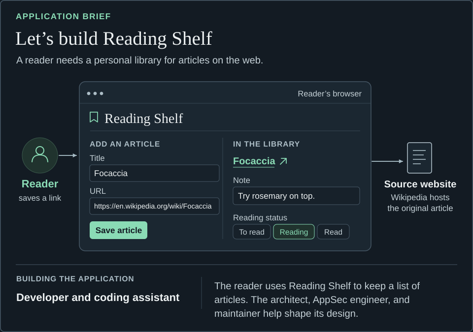

# Reading Shelf

> **Disclaimer:** This repository is a runnable educational example for showcasing the methodology
> of using Continuous Assurance skills. It is not intended as a production application.
> The code, build prompts, and recorded walkthrough are provided
> to demonstrate the methodology and support learning.

The [Continuous Assurance repository](https://github.com/hirendra-rathor/continuous-assurance) provides two skills for applying a design methodology with a coding assistant. The skills use six design perspectives to connect what a user expects with the parts of the system responsible for that behavior and the tests that show whether it works.

- **Design Proposal** helps you compare a requested change with current behavior, review the design decisions, and agree on how to verify the result before implementation.
- **Explore Design** helps you understand how the system works today by tracing a question through its code, tests, and documentation.

For an introduction to the methodology behind these skills, read [Enforcing Design Methodology with Coding Assistants](https://hirendra-rathor.github.io/articles/enforcing-design-methodology-with-coding-assistants/).

Reading Shelf uses a personal reading library as an example scenario for applying Continuous Assurance skills to software design, implementation, and verification. The [Reading Shelf walkthrough](https://hirendra-rathor.github.io/examples/reading-shelf/) shows the prompts we gave Claude Code, the proposals and diagrams it produced with the Design Proposal skill, and screenshots of the application at each milestone.

The `codex` branch contains the implementation built with Codex, and the `claude` branch contains the implementation built with Claude Code.

## Work through the example

Install the skills by following the instructions in the [Continuous Assurance repository](https://github.com/hirendra-rathor/continuous-assurance).

From a fresh clone of `main`, use the [three build prompts](docs/build-prompts.md) to work through the Reading Shelf example one milestone at a time. First, save an article with a note and reading status. Then organize articles into collections. Finally, add archiving and restoring.

Give your coding assistant one prompt at a time. Review the proposal, ask for any changes you want, and then have the assistant implement the agreed design. Try the behavior yourself and run the tests before moving to the next prompt.

## License

The application and tutorial materials are available under the [MIT License](LICENSE).
