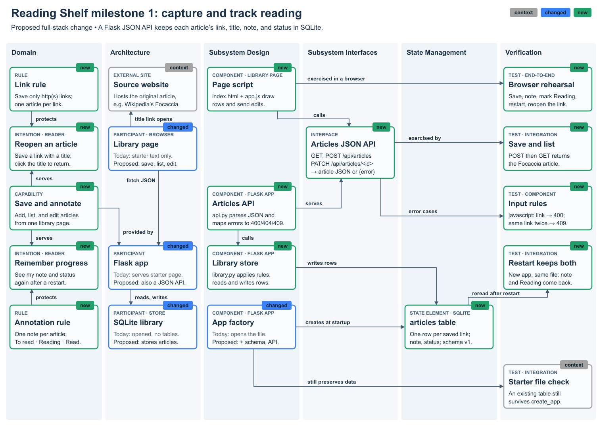
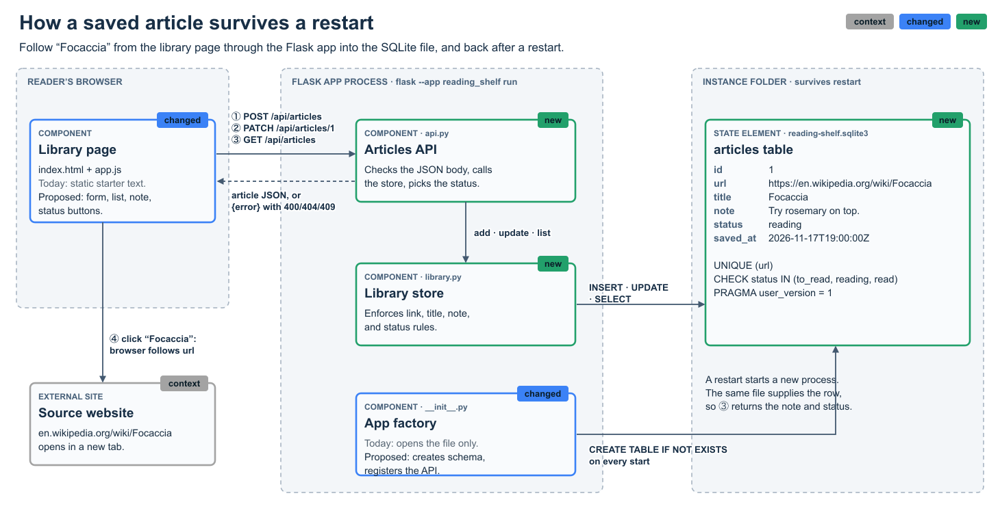
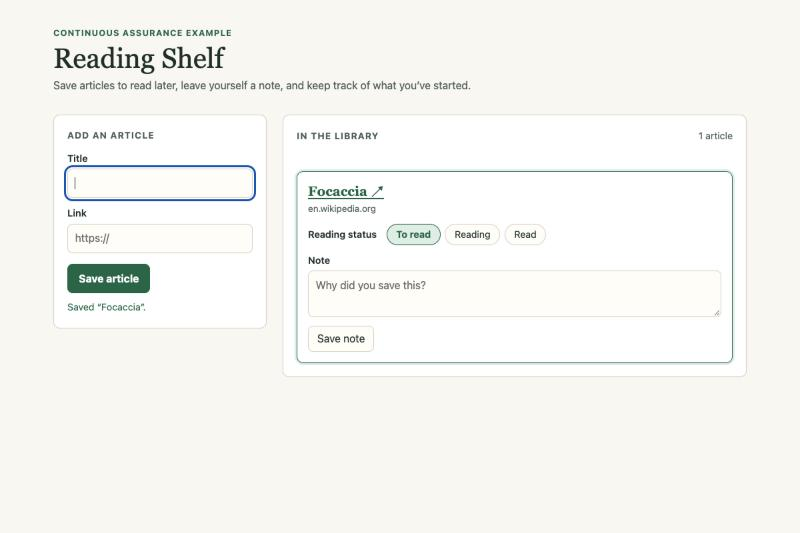
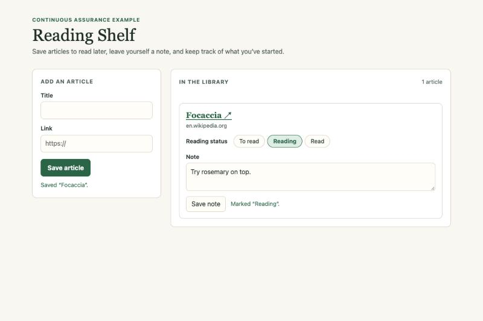
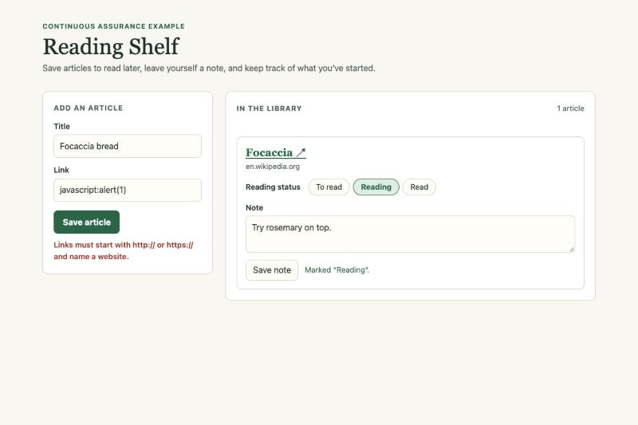
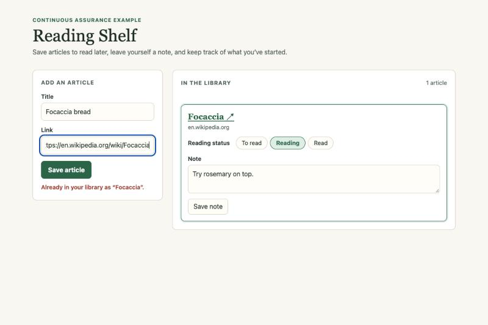
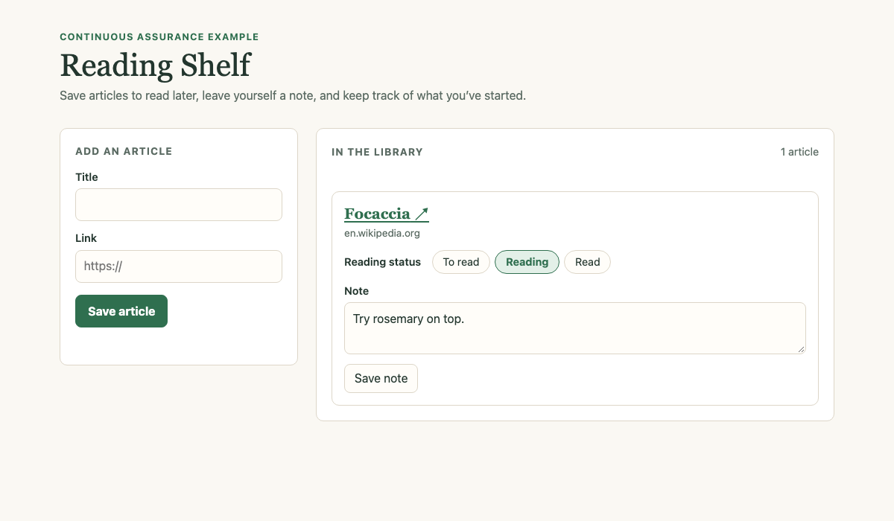

# Milestone 1: Capture and track reading

*Claude Code build.* [Recording index](README.md) · Baseline: the shared starter

**How to read this chapter.** Plain text, like this paragraph, is editorial. Text in quoted blocks is a recorded, user-visible response from the Claude Code session, reproduced verbatim from the capture made when it was shown. The only edit inside quoted blocks is to image paths: during the session the figures were rendered to a temporary folder, and here they point at the copies in [`assets/milestone-1/diagrams/`](assets/milestone-1/diagrams/).

## Prompt

The first prompt from the [build guide](../build-prompts.md#1-capture-and-track-reading), used exactly as written. It was passed to the Design Proposal skill with `/ca-design-proposal`.

```text
I would like to develop a full-stack application called Reading Shelf. When I
come across an article I want to read later, I’d like to paste in the link,
give it a title, and save it. Then, when I have time to read, I can open my
library and click the title to get back to the original article.

I often forget why I saved something, so I’d like a place to leave myself a
note. One note per article is plenty, as long as I can edit it later. I’d also
like to keep track of what I’ve started reading. I think “To read”, “Reading”,
and “Read” would cover it. If I leave a note and mark an article “Reading”,
I’d expect to see that note and status again after I restart the app.

I’d like to use Flask to serve the page and a JSON API. Plain HTML, CSS, and
JavaScript are fine for the page, and I’d like to keep my library in a local
SQLite database.

Give me a design proposal [use $ca-design-proposal].
```

## Design proposal (recorded)

The session loaded the installed Design Proposal skill (`ca-design-proposal`), read its reference guides, and investigated the starter checkpoint read-only before writing this response. The two figures are explanatory proposal diagrams drawn for the response, not screenshots of the application. Their editable sources are [overview.svg](assets/milestone-1/diagrams/overview.svg) and [collaboration.svg](assets/milestone-1/diagrams/collaboration.svg).

> A reader who finds articles they can't read right away needs one place to save each link with a title, remember why they saved it, and track how far they've got — and to find that note and status unchanged after the app restarts.
>
> 
>
> **Comparison baseline.** I compared against the starter checkpoint (“Create the Reading Shelf starter”). Today `create_app` in `reading_shelf/__init__.py` opens `instance/reading-shelf.sqlite3` and reads `PRAGMA schema_version`, so an unreadable file fails at startup. `GET /` sends a static page that only describes this milestone. There are no tables, no API, and nothing can be saved. The one test, `tests/test_starter.py`, checks that the page is served and that a table written into the file survives a second `create_app`. Apart from that page route, the file location and that check, everything below is new.
>
> ### Domain
>
> **Intentions** (both from your request). *Reopen an article*: save a link with a title, and later click the title to get back to the original page. *Remember progress*: see the note and reading status again after a restart. The required capability **Save and annotate** serves both: add an article, list the library, and edit each article's note and status from one page.
>
> **Concepts.** An *article* is a saved link with a title, one note and one reading status. The statuses are *To read*, *Reading* and *Read*; a new article starts as *To read*.
>
> **Rules.**
> - *Link rule* (proposed). A link must be an absolute `http` or `https` URL, and a title must be non-blank after trimming. The title becomes a clickable link, so a `javascript:` or `data:` value would run inside the reader's page; rejecting other schemes protects *Reopen an article*.
> - *Annotation rule* (from your request). One note per article; editing replaces it and an empty note clears it. The status is always exactly one of the three values.
> - *One article per link* (open choice, below).
>
> **Saving the same link twice.** The request doesn't say. Input: save `https://en.wikipedia.org/wiki/Focaccia` as “Focaccia”, then save it again as “Focaccia bread”.
>
> | Rule | What the reader sees |
> | --- | --- |
> | One article per link (recommended) | The second save is refused with “Already in your library”; the list still shows one Focaccia with its note and status. |
> | Allow duplicates | Two Focaccia rows, each with its own note and status; the reader has to remember which note is current. |
>
> I recommend one article per link because it keeps “one note per article” true from the reader's side. Links are compared exactly after trimming spaces, so `…/Focaccia` and `…/Focaccia/` are different links; URL normalisation is out of scope.
>
> ### Architecture
>
> **Architectural participants.** The **Library page** in the reader's browser changes from static text to a save form, a library list, and note and status controls per article. The **Flask app** keeps serving `/` and adds a JSON API under `/api`. The **SQLite library** file stays at `instance/reading-shelf.sqlite3` and changes from an empty file to the store of articles. The **Source website** is context: clicking a title navigates the browser there directly; Flask never fetches articles.
>
> **Runtime units.** One `flask run` process serves the page and API. Each request opens its own SQLite connection, so a restart is a new process reading the same file.
>
> ### Subsystem Design
>
> Package `reading_shelf`:
>
> | Package or module | Components | Today → Proposed |
> | --- | --- | --- |
> | `__init__.py` `changed` | App factory `create_app` | Opens the file and reads its schema version → also creates the `articles` table if it is missing and registers the API. |
> | `library.py` `new` | Library store | Nothing → applies the rules and reads and writes article rows, one transaction per operation. |
> | `api.py` `new` | Articles API (Flask blueprint) | Nothing → parses JSON, calls the store, maps rule failures to 400, 404 and 409. |
> | `static/index.html` `changed`, `static/app.js` `new`, `static/styles.css` `new` | Library page and page script | Static starter text → save form, list, title links, note editor, status buttons. User text is rendered with `textContent`, never as HTML. |
>
> ### Subsystem Interfaces
>
> All three endpoints are new; `GET /` is unchanged context.
>
> | Interface | Request | Response |
> | --- | --- | --- |
> | `GET /api/articles` | — | `200 {"articles": [...]}`, newest first |
> | `POST /api/articles` | `{"url", "title"}` | `201` article; `400 {"error"}` for a bad link or blank title; `409 {"error", "article"}` when the link is already saved |
> | `PATCH /api/articles/<id>` | `{"note"}` and/or `{"status"}` | `200` article; `400` for an unknown status or a non-text note; `404` for an unknown id |
>
> **Exchanges.** An article is `{"id", "url", "title", "note", "status", "saved_at"}`. Status travels as `to_read`, `reading` or `read`; the page shows “To read”, “Reading” and “Read”. Link and title are fixed once saved in this milestone.
>
> ### State Management
>
> **`articles` table** (new). One row per saved link: `id INTEGER PRIMARY KEY`, `url TEXT NOT NULL UNIQUE`, `title TEXT NOT NULL`, `note TEXT NOT NULL DEFAULT ''`, `status TEXT NOT NULL DEFAULT 'to_read'` with a `CHECK` on the three values, and `saved_at` (UTC ISO-8601). `POST` inserts, `PATCH` updates the same row, `GET` selects. The `UNIQUE` and `CHECK` constraints back the rules even if a later caller bypasses the store. `PRAGMA user_version` becomes `1` so later milestones can migrate an existing library instead of recreating it.
>
> **Persistence and recovery.** Each write commits before the response is sent, so a `200` or `201` means the change is in the file. `create_app` uses `CREATE TABLE IF NOT EXISTS`, so a restart never clears the library, and a starter file with unrelated tables keeps them. A failed write rolls back; the page shows the error and keeps what the reader typed.
>
> 
>
> The collaboration view follows Focaccia: ① saving creates row 1 as *To read*; ② the reader writes “Try rosemary on top.” and picks *Reading*, which updates the same row; after a restart ③ listing returns that row unchanged; ④ clicking the title is ordinary browser navigation to the stored URL, opened in a new tab with `rel="noopener noreferrer"`.
>
> ### Verification
>
> Run `uv run --locked python -m pytest`. The automated checks use Flask's test client against a real SQLite file in a temporary instance folder; nothing is stubbed.
>
> | Tests | Expected assertion or signal |
> | --- | --- |
> | Save and list `[integration]` | `POST` Focaccia → `201`, status `to_read`, empty note; `GET` lists it with the same id and url. |
> | Restart keeps both `[integration]` | `PATCH` note “Try rosemary on top.” and status `reading`; a **new** `create_app` on the same folder returns both. It fails if writes aren't committed or start-up recreates the table. |
> | Input rules `[component]` | `javascript:alert(1)` and `ftp://` links → 400; blank title → 400; status `done` → 400; the same link twice → 409 with one row left; unknown id → 404. |
> | Note replaces `[integration]` | A second note replaces the first; `""` clears it. |
> | Starter file check `[integration]` (existing) | Still passes: an unrelated table survives `create_app`. |
> | Browser rehearsal `[end-to-end]`, manual | Save Focaccia, add the note, choose *Reading*, restart the server, reload: the note and *Reading* are shown, and clicking the title opens the Wikipedia article. |
>
> The automated tests don't run the JavaScript; the browser rehearsal covers the page script.
>
> Do you approve this design, or would you like revisions? In particular, please confirm **one article per link** (a repeated save is refused with 409) rather than allowing duplicates.

## Authorization to implement

No separate approval message was sent for this milestone, and none is implied here. The task instruction for this build gave standing authorization to proceed from each completed proposal to implementation without asking for a separate approval. The proposal above still ends with the Design Proposal skill's approval question; the session then showed this note and began implementing:

> *Proceeding under your standing authorization:* your task instruction authorizes moving from each completed proposal to implementation without a separate approval, so I'm implementing this design as proposed, including the recommended one-article-per-link rule.

## Implementation report (recorded)

Shown after the implementation was committed, the full test suite had run, and the browser rehearsal was complete.

> ## Milestone 1 implementation report — capture and track reading
>
> Implemented as proposed and committed on `claude` (“Implement milestone 1: capture and track reading”).
>
> ### What changed
>
> | Module | Change |
> | --- | --- |
> | `reading_shelf/library.py` (new) | Library store: `articles` table (`UNIQUE url`, `CHECK` on status, `user_version = 1`), the link/title/note/status rules, and one-article-per-link with a `409` carrying the existing article. Each write runs in an explicit `BEGIN IMMEDIATE … COMMIT` transaction. |
> | `reading_shelf/api.py` (new) | Articles API blueprint: `GET`/`POST /api/articles`, `PATCH /api/articles/<id>`; maps rule failures to `400`, `404` and `409` with `{"error"}`. One SQLite connection per request, closed on teardown. |
> | `reading_shelf/__init__.py` | `create_app` now creates the schema if it is missing (still failing at startup on an unreadable file) and registers the API. |
> | `reading_shelf/static/` | `index.html` is now the library page (form, list, status buttons, note editor); new `app.js` renders it with `textContent` and keeps typed text on errors; new `styles.css`. |
> | `tests/` | `conftest.py` fixtures with a real temporary instance folder and a `restart()` helper; `test_articles_api.py` and `test_article_rules.py`. `test_starter.py` is unchanged. |
>
> Small additions beyond the proposal's interface table, none of which change its rules: `GET /api/articles/<id>` returns one article (used by tests); titles have inner whitespace collapsed; links containing spaces or control characters are refused; titles are capped at 300 characters and notes at 10,000. The note is saved with **Save note** (or ⌘/Ctrl+Enter); status buttons save immediately.
>
> ### Checks run
>
> `uv run --locked python -m pytest` → **42 passed**.
>
> | Tests | Result |
> | --- | --- |
> | Save and list `[integration]` — `test_articles_api.py` | Passed: Focaccia saved as `to_read` with an empty note and listed with the same id; newest first. |
> | Restart keeps both `[integration]` — `test_note_and_reading_status_survive_a_restart` | Passed: after `PATCH` note “Try rosemary on top.” and `reading`, a new `create_app` on the same folder returns both. |
> | Note replaces `[integration]` | Passed: a second note replaces the first, `""` clears it, and status changes keep the note. |
> | Input rules `[component]` — `test_article_rules.py` (34 cases) | Passed: `javascript:`, `data:`, `ftp:` and scheme-less links → 400; blank or over-long titles → 400; unknown status, non-text note, `title`/`url` edits → 400 with the article unchanged; same link twice (even with spaces) → 409 and one row; unknown id → 404; non-object JSON → 400; the table itself rejects a bad status and a duplicate url. |
> | Starter file check `[integration]` (existing) | Passed unchanged. |
>
> ### Browser rehearsal `[end-to-end]`
>
> I ran `uv run --locked flask --app reading_shelf run --port 5050` with a fresh `instance/` folder and drove the page in the built-in browser:
>
> 1. Saved **Focaccia** with `https://en.wikipedia.org/wiki/Focaccia` → it appeared as *To read* with “Saved “Focaccia”.”
> 2. Typed “Try rosemary on top.”, clicked **Save note**, then **Reading** → “Marked “Reading”.”
> 3. Tried `javascript:alert(1)` → refused with “Links must start with http:// or https:// and name a website.”; still one article.
> 4. Tried the Focaccia link again as “Focaccia bread” → “Already in your library as “Focaccia”.” and the existing card was highlighted.
> 5. Stopped the server, started it again, reloaded → Focaccia still shows the note and *Reading* (`aria-pressed="true"`); the file holds `1|…/Focaccia|Focaccia|Try rosemary on top.|reading`.
> 6. Clicked the title → the page asked to open `en.wikipedia.org` in a new tab. The built-in browser blocks new tabs started by the assistant, so the article itself did not open there; I confirmed the link's `href` is the saved URL with `target="_blank"` and `rel="noopener noreferrer"`.
>
> ### Limits
>
> The page script is exercised only by the manual rehearsal; the automated tests don't run JavaScript. Opening the article in a new tab was blocked by the assistant's browser, as described in step 6, so that last click is verified by its link attributes rather than by viewing Wikipedia.

## Screenshots of the working application

These are screenshots of this implementation running locally with `uv run --locked flask --app reading_shelf run --port 5050`, taken during the browser rehearsal described in the report. Screenshots 1–4 were captured by the built-in browser in the Claude desktop app (1200 × 800 viewport, saved by the tool as 800 × 533 JPEG). Screenshot 5 was captured with headless Google Chrome at 1200 × 700 from the same server after the restart.

### 1. Focaccia saved as To read

Rehearsal step 1: the article appears in the library with an empty note and the default status.



### 2. Note saved and marked Reading

Rehearsal step 2: the note “Try rosemary on top.” is saved and the status is set to Reading.



### 3. Unsafe link refused

Rehearsal step 3: a `javascript:` link is refused by the API and the page keeps what was typed.



### 4. Same link refused

Rehearsal step 4: saving the Focaccia link again under another title is refused and the existing article is highlighted.



### 5. After a restart

Rehearsal step 5: after stopping and restarting the server, the reloaded page shows the same note and Reading status.



## Navigation

[Recording index](README.md) · [Build prompts](../build-prompts.md) · [Project README](../../README.md)
