# Milestone 2: Organize the library

*Claude Code build.* [Recording index](README.md) · Baseline: [milestone 1](milestone-1-capture-and-track-reading.md)

**How to read this chapter.** Plain text, like this paragraph, is editorial. Text in quoted blocks is a recorded, user-visible response from the Claude Code session, reproduced verbatim from the capture made when it was shown. The only edit inside quoted blocks is to image paths: during the session the figures were rendered to a temporary folder, and here they point at the copies in [`assets/milestone-2/diagrams/`](assets/milestone-2/diagrams/).

## Prompt

The second prompt from the [build guide](../build-prompts.md#2-organize-the-library), used exactly as written. It was passed to the Design Proposal skill with `/ca-design-proposal`. The comparison baseline was this build's milestone 1 implementation.

```text
Now I’d like the app to support organizing the articles I’ve already saved.
Could you help me figure out how collections would work? I’d like to name them
myself. For example, I might make one called “Food and cooking” and another
called “Weekend reading”. Sometimes I’ll want to put the same article in both.

Say I open that article from “Food and cooking” and change my note. When I
open it later from “Weekend reading”, I’d expect to see the note I just wrote.
And if I decide it doesn’t belong in “Food and cooking” anymore, I’d like to
take it out of that collection and still find it in “Weekend reading” and in
my main library.

I’d also like to see just the articles I’ve marked “Reading”. Sometimes I’d
want that list for my whole library, and sometimes just for one collection. If
I finish an article and mark it “Read” in one collection, it should drop off
the “Reading” list in the other one too.

Give me a design proposal [use $ca-design-proposal].
```

## Design proposal (recorded)

The session invoked the Design Proposal skill again and investigated the milestone 1 implementation read-only before writing this response. The two figures are explanatory proposal diagrams, not screenshots of the application. Their editable sources are [overview.svg](assets/milestone-2/diagrams/overview.svg) and [collaboration.svg](assets/milestone-2/diagrams/collaboration.svg).

> A reader whose library is growing needs to group saved articles under names they choose, with one article allowed in several groups, and to narrow any view to what they're reading now, without the groups ever disagreeing about an article's note or status.
>
> 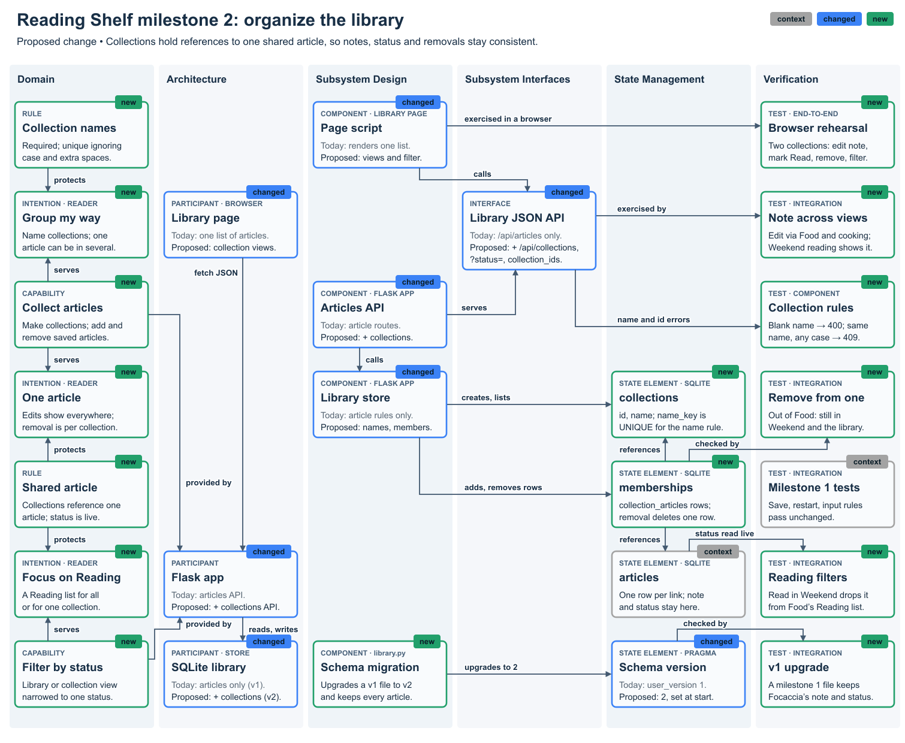
>
> **Comparison baseline.** I compared against the milestone 1 implementation on `claude`. Today the library is one flat list: `GET /api/articles` returns every article, newest first, and each article's note and status are columns on its single `articles` row (`Library.update_article` in `reading_shelf/library.py`). There are no groups, no filtering, and the schema is `user_version = 1`. `library.connect()` doesn't turn on SQLite foreign keys. An existing library file, such as one holding Focaccia marked *Reading* with “Try rosemary on top.”, must keep working.
>
> ### Domain
>
> **Intentions** (from your request). *Group my way*: create named collections such as “Food and cooking” and “Weekend reading”, and put one article in several. *One article*: an edit made while viewing one collection shows in every other, and taking an article out of one collection leaves it in the others and in the library. *Focus on Reading*: a list of just the *Reading* articles, for the whole library or for one collection. The milestone 1 intentions (reopen an article, remember progress) are unchanged context.
>
> **Concepts.** A *collection* is a named group the reader creates. A *membership* records that one article is in one collection. A *view* is the library or one collection, optionally narrowed to one status.
>
> **Required capabilities.** *Collect articles* (create collections, add and remove articles) serves the first two intentions. *Filter by status* serves the third.
>
> **Rules.**
> - *Shared article* (proposed; it follows from your examples). A collection holds references to articles, never copies. Note and status stay on the article, so an edit made from “Food and cooking” is what “Weekend reading” shows, and a status filter always reads the article's current status: marking it *Read* anywhere removes it from every *Reading* list. Removing an article from a collection deletes only that membership.
> - Adding an article that is already in a collection changes nothing; removing one that isn't there changes nothing either.
> - *Collection names* (open choice, below).
>
> **Two names that differ only in case.** Input: create “Food and cooking”, then “food and  cooking”.
>
> | Rule | What the reader sees |
> | --- | --- |
> | Unique ignoring case and extra spaces (recommended) | The second is refused: “You already have a collection called “Food and cooking”.” |
> | Unique only when identical | Two collections that look the same in the sidebar, with articles split between them by accident. |
>
> I recommend the first. Names are trimmed, inner spaces collapsed, and limited to 80 characters; a blank name is refused. Renaming and deleting collections aren't in the request, so I've left them out of this milestone.
>
> ### Architecture
>
> **Architectural participants** are the same three; their duties grow. The **Library page** changes from one list to views: a collections sidebar, a status filter, and collection chips on each article. The **Flask app** adds collection endpoints to its JSON API. The **SQLite library** gains two tables and moves to schema version 2. Runtime units are unchanged.
>
> ### Subsystem Design
>
> Package `reading_shelf`:
>
> | Package or module | Components | Today → Proposed |
> | --- | --- | --- |
> | `library.py` `changed` | Library store | Article rules only → also the collection-name rule, adding and removing memberships, and listing by collection and status; foreign keys on for every connection. |
> | `library.py` `new` | Schema migration (`initialize`) | Creates the v1 table → upgrades a v1 file to v2 in one transaction, and refuses a file newer than v2. |
> | `api.py` `changed` | Articles API | Article routes → plus collection routes and `?status=`. |
> | `static/` `changed` | Library page | One list → sidebar of collections with counts, a “New collection” form, an All / To read / Reading / Read filter, chips with remove buttons, and an “Add to collection” menu on each article. The view is kept in the URL fragment (`#collection=2&status=reading`), so a reload keeps it. |
>
> Opening an article “from” a collection means its card in that collection's view. The note editor there sends the same `PATCH /api/articles/<id>` as the library view, and every view re-reads its articles when shown. The add form still saves to the library only; it doesn't file the article into the open collection.
>
> ### Subsystem Interfaces
>
> | Interface | Request | Response |
> | --- | --- | --- |
> | `GET /api/articles` `changed` | optional `?status=reading` | `200 {"articles"}`; `400` for an unknown status |
> | `GET /api/collections` `new` | — | `200 {"collections": [{"id", "name", "article_count"}]}`, sorted by name |
> | `POST /api/collections` `new` | `{"name"}` | `201` collection; `400` blank or too long; `409 {"error", "collection"}` for a name in use |
> | `GET /api/collections/<id>/articles` `new` | optional `?status=` | `200 {"collection", "articles"}`; `404` unknown collection |
> | `PUT /api/collections/<id>/articles/<article_id>` `new` | — | `200` article; repeatable; `404` unknown collection or article |
> | `DELETE /api/collections/<id>/articles/<article_id>` `new` | — | `200` article; repeatable; `404` unknown collection or article |
>
> **Exchanges.** The article object gains `collection_ids`. Existing fields are unchanged, so milestone 1 callers keep working.
>
> ### State Management
>
> **`collections`** (new): `id`, `name` as typed (spacing normalised), `name_key` (casefolded name) with `UNIQUE`, and `created_at`. **`collection_articles`** (new): `collection_id`, `article_id`, `added_at`, with the pair as primary key and both foreign keys `ON DELETE CASCADE`. **`articles`** is unchanged context: its note and status columns are the one source every view reads.
>
> **Schema version and recovery.** Today `initialize` ensures the articles table and sets `user_version = 1`. Proposed: a version 1 file is upgraded in one `BEGIN IMMEDIATE` transaction that creates the two tables and sets version 2. If that fails it rolls back, the v1 file is left as it was, and the app doesn't start. A version above 2 stops start-up instead of risking writes to a newer layout.
>
> 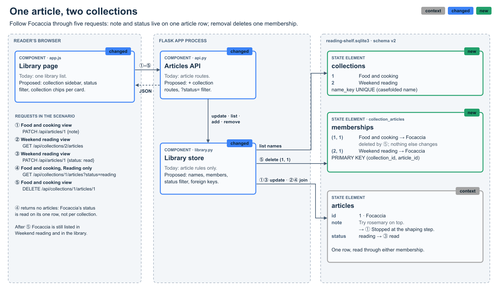
>
> The collaboration view follows Focaccia, already *Reading* with “Try rosemary on top.”, in both collections: ① the note becomes “Stopped at the shaping step.” from “Food and cooking”; ② “Weekend reading” shows that note because both memberships point at article 1; ③ marking it *Read* in “Weekend reading” updates the same row, so ④ “Food and cooking” filtered to *Reading* is empty; ⑤ removing it from “Food and cooking” deletes membership (1, 1) only, and it stays in “Weekend reading” and the library.
>
> ### Verification
>
> Run `uv run --locked python -m pytest`. Every check uses a real SQLite file through Flask's test client.
>
> | Tests | Expected assertion or signal |
> | --- | --- |
> | Note across views `[integration]` | After `PATCH` of Focaccia's note, `GET /api/collections/<weekend>/articles` returns the new note. It would fail if collections copied article fields. |
> | Reading filters `[integration]` | `?status=reading` lists Focaccia in the library and both collections; after `PATCH status=read`, it's gone from all three Reading lists. |
> | Remove from one `[integration]` | After `DELETE` from Food, Food is empty, Weekend and the library still list Focaccia with its note and status, and `collection_ids` is `[weekend]`. |
> | Collection rules `[component]` | Blank or 81-character name → 400; “ food AND  cooking ” → 409 with the existing collection; unknown collection or article → 404; adding twice leaves one membership; bad `?status` → 400. |
> | Persistence and upgrade `[integration]` | Collections and memberships survive a restart; a file built with the milestone 1 schema and holding Focaccia upgrades to version 2 with its note and status intact; a version 3 file stops start-up. |
> | Milestone 1 tests (existing) | Pass unchanged. |
> | Browser rehearsal `[end-to-end]`, manual | The scenario above in the page, with the Reading filter in each view and a restart. |
>
> Do you approve this design, or would you like changes? In particular, please confirm that **collection names are unique ignoring case and spacing**, and that **renaming and deleting collections** can wait for a later milestone.

## Authorization to implement

No separate approval message was sent for this milestone, and none is implied here. The task instruction for this build gave standing authorization to proceed from each completed proposal to implementation without asking for a separate approval. The proposal above still ends with the Design Proposal skill's approval question; the session then showed this note and began implementing:

> *Proceeding under your standing authorization:* your task instruction authorizes moving from each completed proposal to implementation without a separate approval, so I'm implementing this design as proposed: collection names unique ignoring case and spacing, with renaming and deleting collections left for later.

## Implementation report (recorded)

Shown after the implementation was committed, the full test suite had run, and the browser rehearsal was complete.

> ## Milestone 2 implementation report — organize the library
>
> Implemented as proposed and committed on `claude` (“Implement milestone 2: organize the library”).
>
> ### What changed
>
> | Module | Change |
> | --- | --- |
> | `reading_shelf/library.py` | New `collections` and `collection_articles` tables; `initialize` now applies ordered migrations in one transaction, moves the file to `user_version = 2`, and raises `UnsupportedLibrary` for a newer file. Every connection turns on foreign keys. New store operations: `create_collection` (name rule, `409` via `DuplicateCollection`), `list_collections` with counts, `list_collection_articles`, repeatable `add_to_collection` / `remove_from_collection`, and a `status` filter on listings. Articles now include `collection_ids`; note and status still live only on the article row. |
> | `reading_shelf/api.py` | `GET`/`POST /api/collections`, `GET /api/collections/<id>`, `GET /api/collections/<id>/articles`, `PUT`/`DELETE /api/collections/<id>/articles/<article_id>`, and `?status=` on both listings (`400` for an unknown status, empty means all). |
> | `reading_shelf/static/` | Collections sidebar with counts and a “New collection” form; All / To read / Reading / Read filter; collection chips with × remove buttons and an “Add to collection…” menu on each article. The view lives in the URL fragment. Status and membership changes update only the affected card, which leaves the current view when it no longer matches, so unsaved notes on other cards are kept. |
> | `tests/` | New `test_collections.py`, `test_collection_rules.py`, `test_schema_upgrade.py`, and helpers in `conftest.py`. |
>
> One departure from “milestone 1 tests pass unchanged”: `test_schema_is_versioned_and_created_only_once` asserted `user_version == 1`; it now asserts `2`, which is the version change this proposal makes. No other milestone 1 test changed. I also added `GET /api/collections/<id>` (one collection with its count), which the proposal's table didn't list.
>
> ### Checks run
>
> `uv run --locked python -m pytest` → **71 passed** (42 from milestone 1, 29 new).
>
> | Tests | Result |
> | --- | --- |
> | Note across views `[integration]` | Passed: the note “Stopped at the shaping step.”, saved for the article opened from Food and cooking, is returned by Weekend reading and the library. |
> | Reading filters `[integration]` | Passed: `?status=reading` lists Focaccia in the library and both collections; after `PATCH status=read` from Weekend reading, all three Reading lists are empty and Food's `?status=read` lists it. |
> | Remove from one `[integration]` | Passed: after `DELETE` from Food, Food is empty, Weekend still lists Focaccia with its note and *Reading*, the library still lists it, and `collection_ids` is `[weekend]`; repeating add or remove changes nothing more. |
> | Collection rules `[component]` (17 cases) | Passed: blank, non-text and 81-character names → 400; “food and cooking”, “ food AND  cooking ” and “FOOD AND COOKING” → 409 naming “Food and cooking”; unknown collection or article → 404; `?status=done`/`Reading`/`READ` → 400; empty `?status=` lists everything. |
> | Persistence and upgrade `[integration]` | Passed: collections and memberships survive a restart; a file written with the milestone 1 schema and holding Focaccia upgrades to version 2 with note and status intact and can then be filed; a version 3 file raises `UnsupportedLibrary` and is left at version 3 with only its `articles` table; the database rejects a membership for a missing article. |
> | Milestone 1 tests | Passed, with the one version assertion updated as described above. |
>
> ### Browser rehearsal `[end-to-end]`
>
> I started the app on the real `instance/` library left by milestone 1 (schema 1, Focaccia *Reading* with “Try rosemary on top.”). Start-up upgraded it: `user_version` became 2 and the new tables appeared, with Focaccia unchanged. Then, in the built-in browser:
>
> 1. Created “Food and cooking” and “Weekend reading”; “food and  cooking” was refused with “You already have a collection called “Food and cooking”.”
> 2. Added Focaccia to both collections from its “Add to collection…” menu, and saved Sourdough into Weekend reading.
> 3. Opened Food and cooking, changed Focaccia's note to “Stopped at the shaping step.” and saved it.
> 4. Opened Weekend reading: Focaccia showed the new note and *Reading*.
> 5. Filtered Weekend reading to *Reading* (only Focaccia), then marked it *Read*: it left the list with “Marked “Focaccia” Read; it no longer matches this view.”
> 6. Opened Food and cooking filtered to *Reading*: “No articles marked Reading in Food and cooking.” The library-wide `GET /api/articles?status=reading` also returned no articles.
> 7. In Food and cooking, removed Focaccia with its × chip: “Removed “Focaccia” from Food and cooking. It’s still in your library.”
> 8. Restarted the server and reloaded: Weekend reading lists Sourdough and Focaccia (*Read*, “Stopped at the shaping step.”, only the Weekend reading chip); All articles lists both; Food and cooking shows 0.
>
> ### Limits
>
> The page script is checked only by this manual rehearsal; the automated tests exercise the API, store and database. Renaming and deleting collections remain out of scope, as the proposal stated.

## Screenshots of the working application

These are screenshots of this implementation, taken during the browser rehearsal described in the report. The app ran with `uv run --locked flask --app reading_shelf run --port 5050` on the library file left by milestone 1, which it upgraded at start-up. Screenshots 1–8 were captured by the built-in browser in the Claude desktop app (1200 × 860 viewport, saved by the tool as 800 × 573 JPEG). Screenshots 9 and 10 were captured with headless Google Chrome at 1200 × 1000 from the same server after the restart.

### 1. Two collections, and a name already in use

Rehearsal step 1: “Food and cooking” and “Weekend reading” exist; “food and  cooking” is refused.

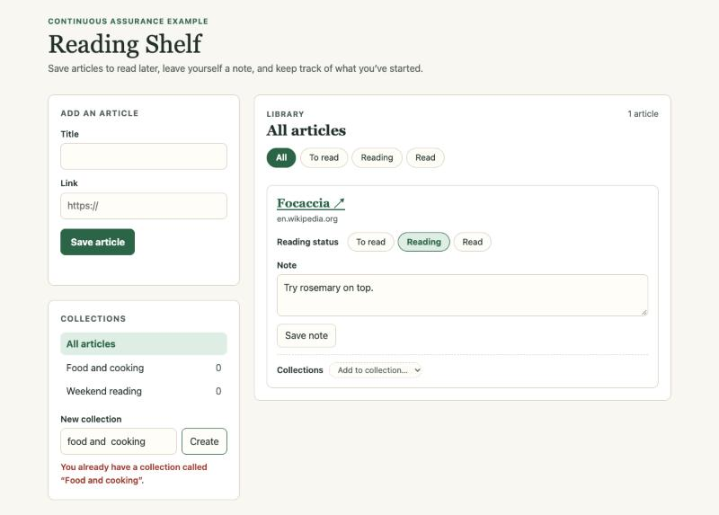

### 2. Focaccia in both collections

Rehearsal step 2: Focaccia's chips show both collections and each count is 1.

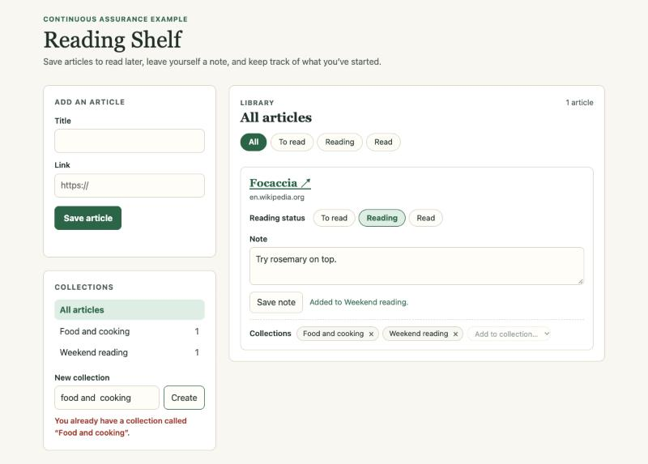

### 3. Note edited in Food and cooking

Rehearsal step 3: the note is changed from the Food and cooking view.

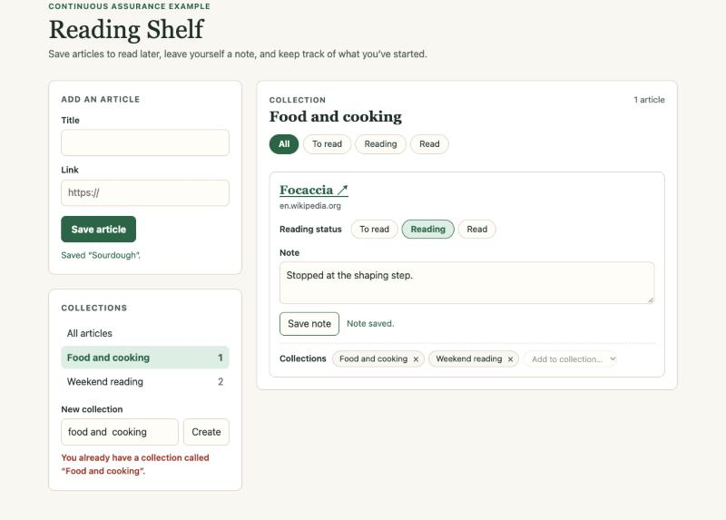

### 4. Same note in Weekend reading

Rehearsal step 4: Weekend reading shows the note written from Food and cooking.

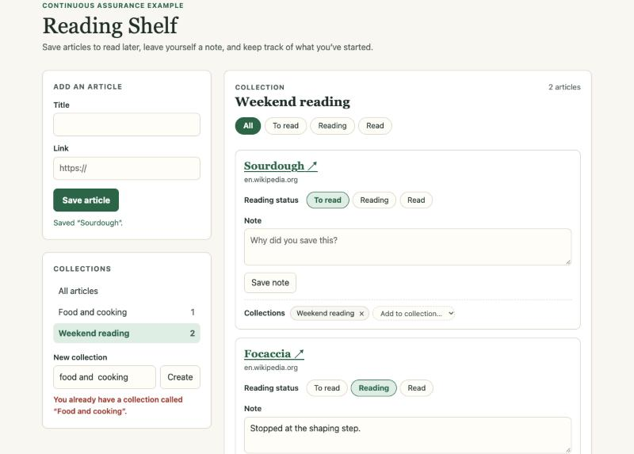

### 5. Weekend reading filtered to Reading

Rehearsal step 5: only Focaccia is marked Reading in Weekend reading.

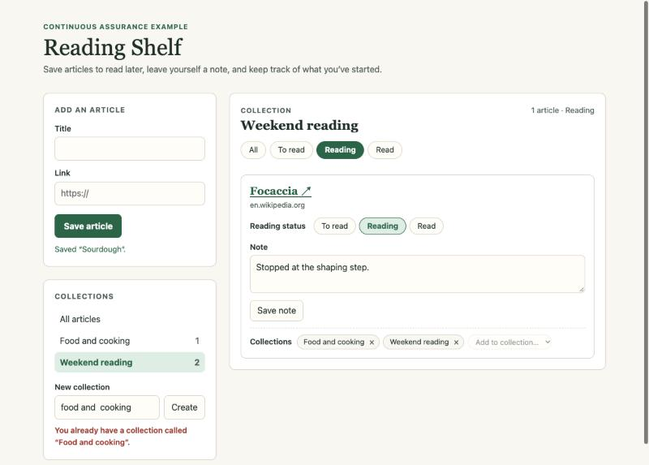

### 6. Marked Read, so it leaves the Reading list

Rehearsal step 5: after marking Focaccia Read from Weekend reading, the filtered view is empty.

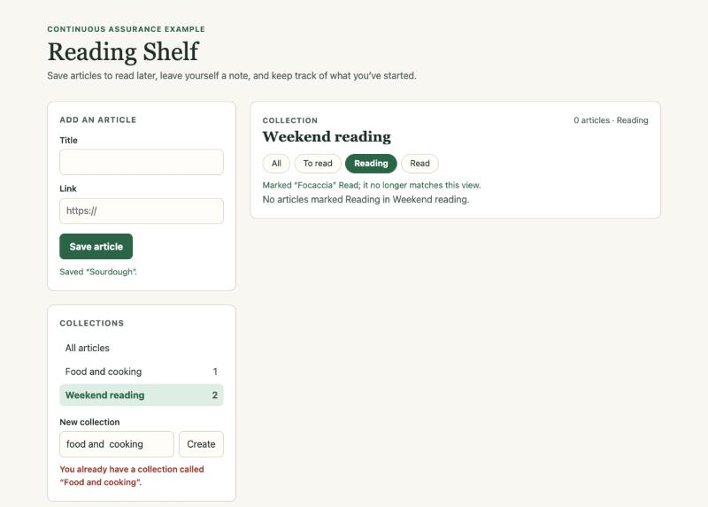

### 7. Food and cooking's Reading list is empty too

Rehearsal step 6: the status change made in Weekend reading also applies in Food and cooking.

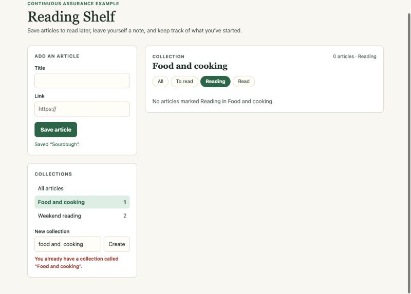

### 8. Removed from Food and cooking only

Rehearsal step 7: removing Focaccia from Food and cooking leaves Weekend reading's count at 2.

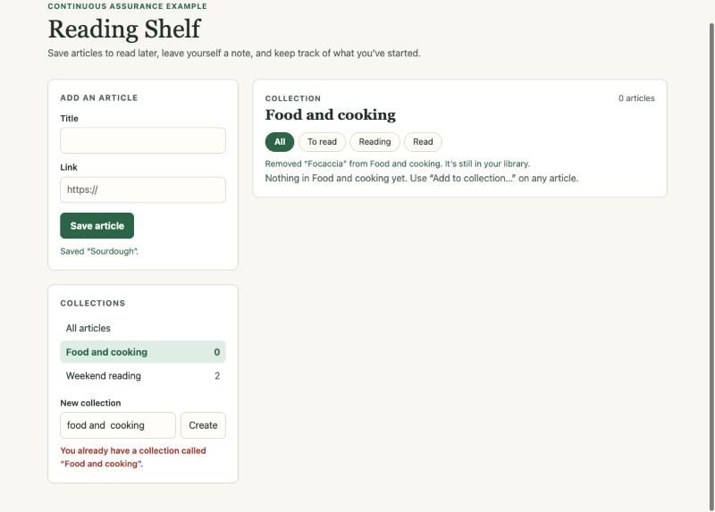

### 9. Weekend reading after a restart

Rehearsal step 8: after restarting the server, Weekend reading still holds Sourdough and Focaccia, with Focaccia's note and Read status.

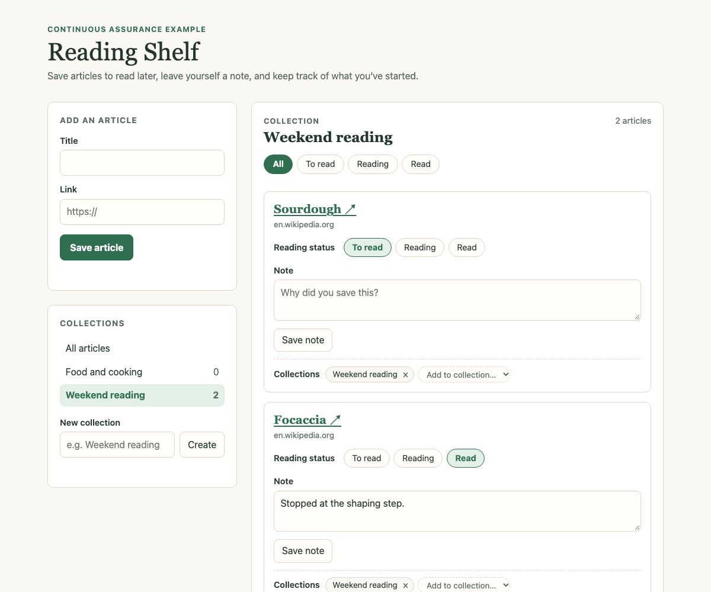

### 10. Library after a restart

Rehearsal step 8: All articles still lists Focaccia, now filed only in Weekend reading.

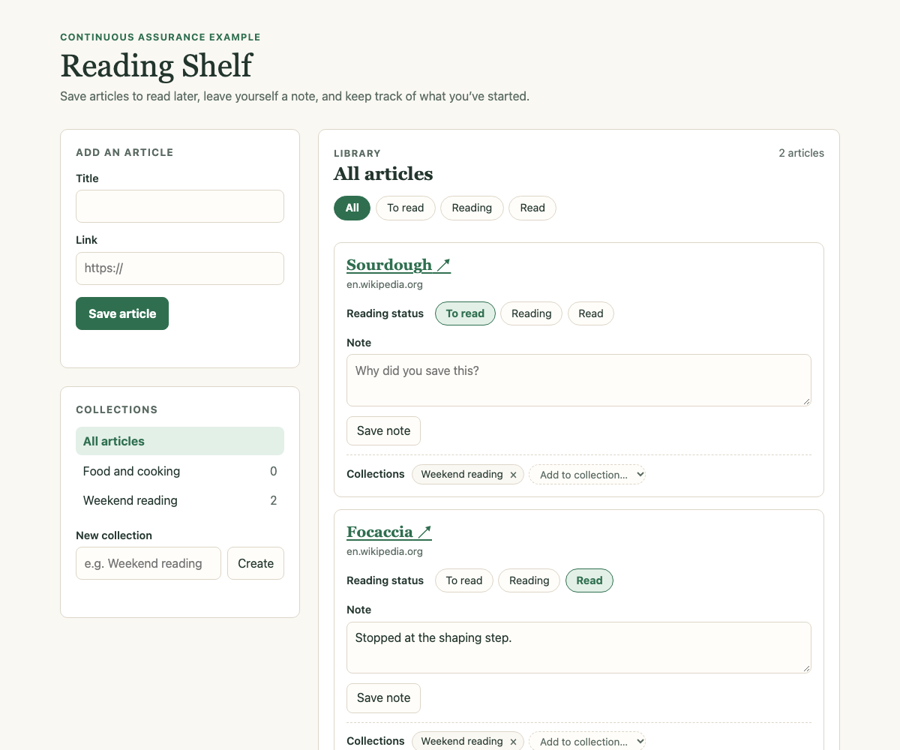

## Navigation

Previous: [Milestone 1: Capture and track reading](milestone-1-capture-and-track-reading.md) · [Recording index](README.md) · [Build prompts](../build-prompts.md)
