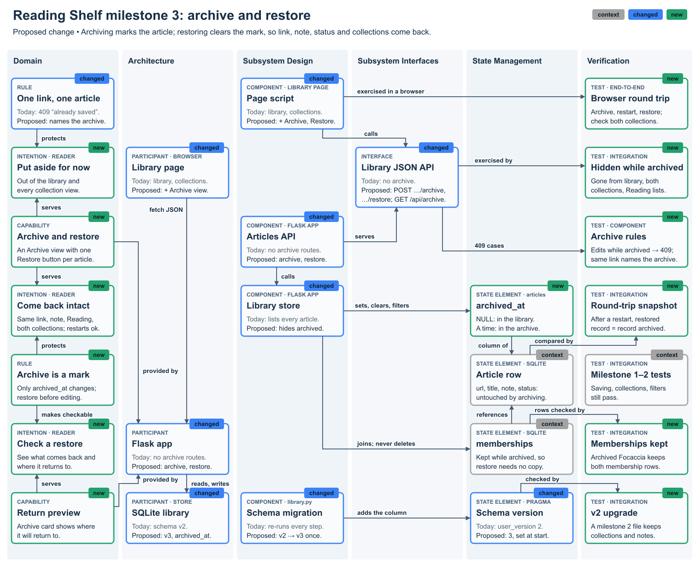
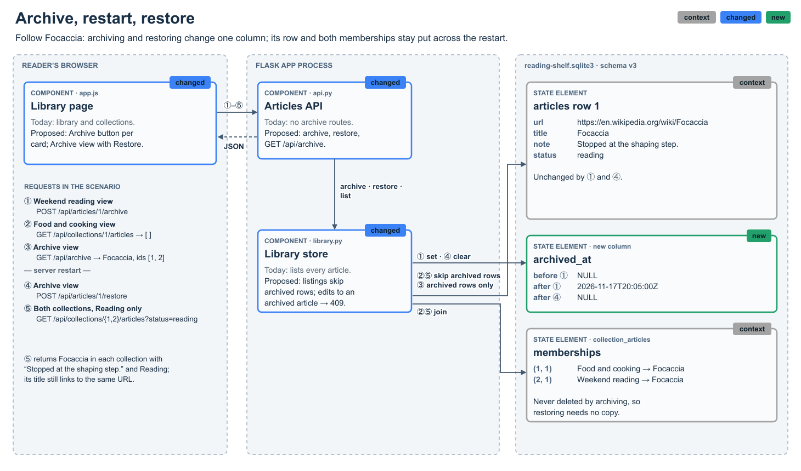
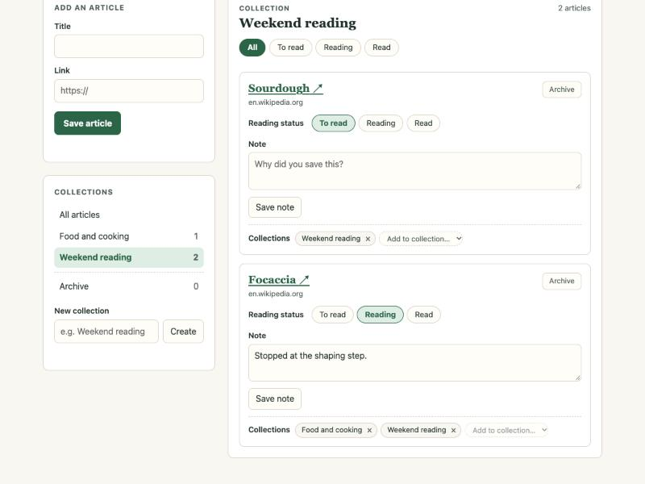
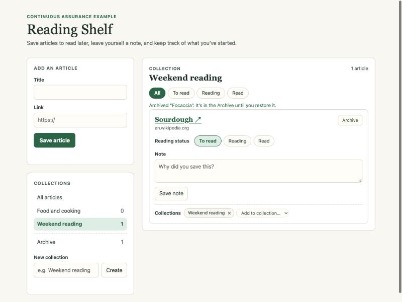
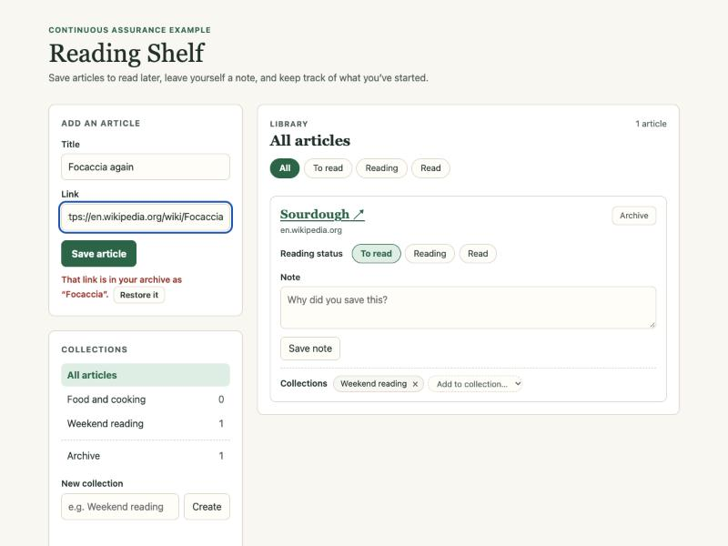
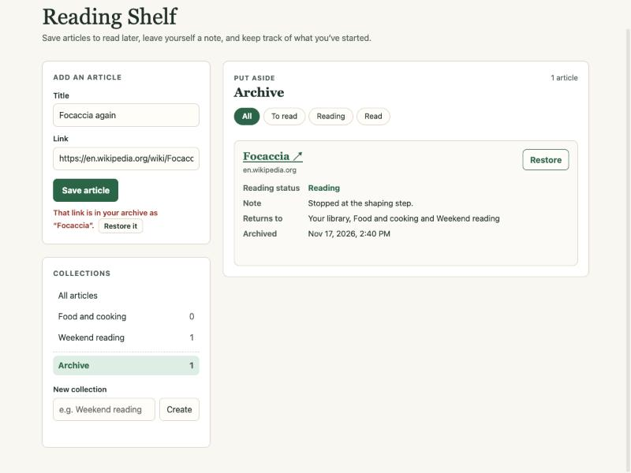
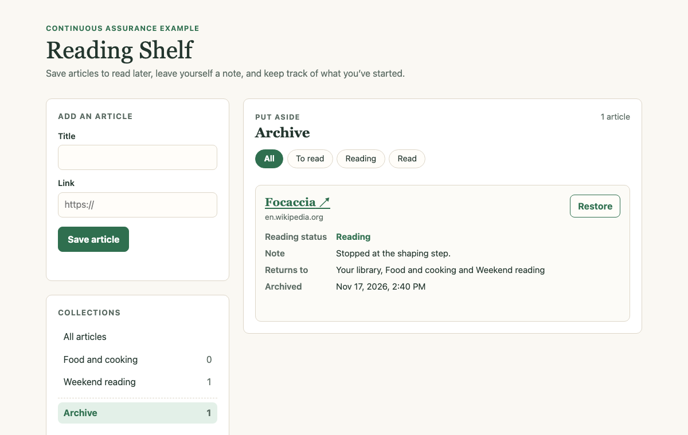
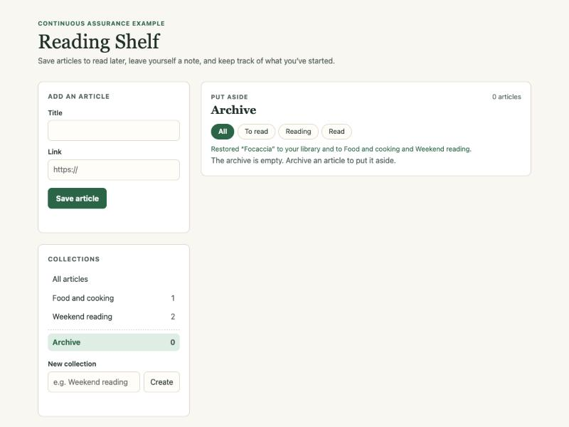
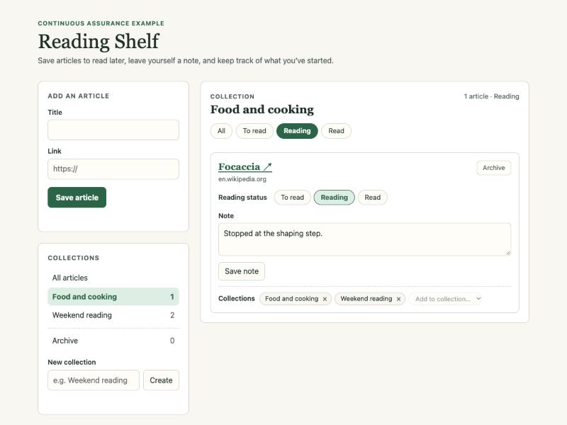
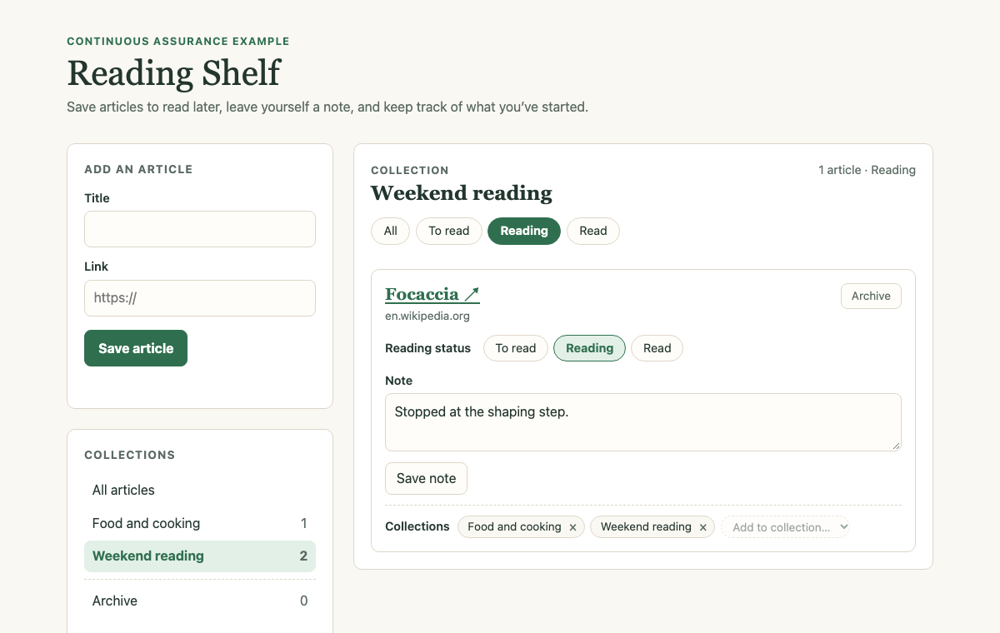

# Milestone 3: Archive and restore

*Claude Code build.* [Recording index](README.md) · Baseline: [milestone 2](milestone-2-organize-the-library.md)

**How to read this chapter.** Plain text, like this paragraph, is editorial. Text in quoted blocks is a recorded, user-visible response from the Claude Code session, reproduced verbatim from the capture made when it was shown. The only edit inside quoted blocks is to image paths: during the session the figures were rendered to a temporary folder, and here they point at the copies in [`assets/milestone-3/diagrams/`](assets/milestone-3/diagrams/).

## Prompt

The third prompt from the [build guide](../build-prompts.md#3-archive-and-restore), used exactly as written, including its closing question about checking a restore. It was passed to the Design Proposal skill with `/ca-design-proposal`. The comparison baseline was this build's milestone 2 implementation.

```text
There are articles I’d like to put aside for a while. I’m thinking of adding
an archive. When I archive an article, I want it out of my main library and
out of the collections I’m browsing. I’d like to be able to open the archive
and find it there when I’m ready to come back to it.

For example, I might be halfway through an article that’s in both
“Food and cooking” and “Weekend reading”. I’ve marked it “Reading” and left
myself a note about where I stopped. Suppose I archive it today. When I
restore it, I’d expect it back in my library and in both collections. I should
be able to click the same title to open the original link, see my note, and
carry on with the article still marked “Reading”. This functionality should
work even if the app is restarted between archiving and restoring.

Give me a design proposal [use $ca-design-proposal].

I’d also like to know how I can check that everything comes back when I
restore one.
```

## Design proposal (recorded)

The session invoked the Design Proposal skill again and investigated the milestone 2 implementation read-only before writing this response. The prompt's question about checking a restore is answered in the proposal's Verification section. The two figures are explanatory proposal diagrams, not screenshots of the application. Their editable sources are [overview.svg](assets/milestone-3/diagrams/overview.svg) and [collaboration.svg](assets/milestone-3/diagrams/collaboration.svg).

> A reader who wants to put an article aside needs it out of sight in the library and in every collection, and needs it back exactly as they left it — same link, note, *Reading* status and collections — whenever they restore it, even after the app has restarted.
>
> 
>
> **Comparison baseline.** I compared against the milestone 2 implementation on `claude`. Today every saved article appears in `GET /api/articles` and in each collection it belongs to; `list_articles`, `list_collection_articles` and the collection counts in `reading_shelf/library.py` have no notion of hiding. The only way an article leaves a collection is `remove_from_collection`, which deletes its membership row. There is no archive. `initialize` re-runs every migration step on each start, which only works because every step so far is `CREATE TABLE IF NOT EXISTS`. The schema is version 2.
>
> ### Domain
>
> **Intentions** (from your request). *Put aside for now*: an archived article leaves the library and every collection view, and can be found in an Archive. *Come back intact*: restoring returns it to the library and to both collections with the same link, note and status, even across a restart. *Check a restore*: you asked how to confirm that everything came back. The milestone 1–2 intentions remain context.
>
> **Required capabilities.** *Archive and restore* (an Archive button on each article, an Archive view, a Restore button) serves the first two. *Return preview* serves the third: an archived card shows where it will return, and the restore message names those collections.
>
> **Rules.**
> - *Archive is a mark* (proposed). Archiving records when the article was archived and changes nothing else; restoring clears that record. Its row and its memberships stay where they are, so what comes back is by construction what was archived. The alternative, moving the article out and recreating it on restore, would have to copy the note, status and memberships correctly, and any slip would lose one.
> - *One link, one article* (changed): today saving a saved link returns `409` “already in your library”; for an archived link the message will say it's in the archive (see below).
> - *Editing while archived* (open choice, below).
>
> **Editing an archived article.** Input: in the Archive, you try to change Focaccia's note.
>
> | Rule | What you see |
> | --- | --- |
> | Read-only until restored (recommended) | The Archive shows the note and status as text, with no editor; a direct API edit gets `409` “Restore this article to change it.” Restoring brings back exactly what you archived. |
> | Editable in the Archive | The new note is saved and comes back on restore. Adding or removing collections while archived would also change where it returns. |
>
> I recommend read-only: it keeps the archive a pause rather than a second place to edit, and makes the round trip easy to check. The same applies to status and collection changes.
>
> **Saving a link that is archived.** Input: paste Focaccia's link into “Add an article” while it's archived.
>
> | Rule | What you see |
> | --- | --- |
> | Refuse and point to the archive (recommended) | “That link is in your archive as “Focaccia”.” with a **Restore it** button. |
> | Restore automatically | Focaccia reappears with its old note and status, under its old title rather than the one just typed. |
>
> I recommend refusing with a Restore button, so nothing comes back without you choosing it.
>
> ### Architecture
>
> **Architectural participants** stay the same. The **Library page** gains an Archive entry in the sidebar and an Archive button on each article. The **Flask app** adds archive and restore endpoints. The **SQLite library** gains one column and moves to schema version 3.
>
> ### Subsystem Design
>
> Package `reading_shelf`:
>
> | Package or module | Components | Today → Proposed |
> | --- | --- | --- |
> | `library.py` `changed` | Library store | Lists every article → library and collection listings, status filters and collection counts skip archived articles; new `archive_article`, `restore_article`, `list_archive`; edits and membership changes to an archived article raise a conflict. |
> | `library.py` `changed` | Schema migration | Re-runs every step on each start → runs only the steps above the file's version, in one transaction; step 3 adds `archived_at`. |
> | `api.py` `changed` | Articles API | No archive routes → archive, restore and archive listing; `409` for the archive conflicts. |
> | `static/` `changed` | Library page | Library and collections → plus an Archive view (title link, read-only note and status, “Returns to” collection list, archived date, Restore) and an Archive button on each active article. |
>
> ### Subsystem Interfaces
>
> | Interface | Request | Response |
> | --- | --- | --- |
> | `POST /api/articles/<id>/archive` `new` | — | `200` article with `archived_at`; repeatable (keeps the first time); `404` unknown id |
> | `POST /api/articles/<id>/restore` `new` | — | `200` article with `archived_at: null`; repeatable; `404` unknown id |
> | `GET /api/archive` `new` | optional `?status=` | `200 {"articles"}`, most recently archived first |
> | `GET /api/articles`, `GET /api/collections…` `changed` | — | Archived articles left out of listings and `article_count` |
> | `PATCH /api/articles/<id>`, `PUT`/`DELETE` membership `changed` | — | `409` while the article is archived |
> | `POST /api/articles` `changed` | archived link | `409 {"error", "article"}` with `archived_at` set |
>
> **Exchanges.** The article object gains `archived_at` (`null` or a UTC time). `GET /api/articles/<id>` still returns an archived article, so its link keeps working.
>
> ### State Management
>
> **`articles.archived_at`** (new) is `NULL` for an article in the library and a UTC timestamp for one in the archive. Archive and restore are each a single `UPDATE` of that column, so there is no partial state to recover from. **The article row** (url, title, note, status) and **`collection_articles`** are context: archiving never touches them, which is why restore needs no copy. A restart reads the same file, so the round trip doesn't depend on the process staying up.
>
> **Schema version.** A version 2 file is upgraded once: one transaction adds the column and sets `user_version = 3`; a failure leaves it at version 2 and stops start-up. Because `ALTER TABLE` can't be repeated, the migration runner changes to apply only steps above the file's version.
>
> 
>
> The collaboration view follows Focaccia, *Reading* with “Stopped at the shaping step.” in both collections: ① archiving sets `archived_at`; ② Food and cooking no longer lists it; ③ the Archive lists it with collection ids 1 and 2; the server restarts; ④ restoring clears the column; ⑤ both collections list it again under *Reading*, with the same note and link.
>
> ### Verification — how to check that everything comes back
>
> Run `uv run --locked python -m pytest`; the checks use a real SQLite file and a fresh `create_app` for each restart.
>
> | Tests | Expected assertion or signal |
> | --- | --- |
> | Round-trip snapshot `[integration]` | Take Focaccia's full record (id, url, title, note, status, `collection_ids`) before archiving; archive; restart; restore; the record is identical and Focaccia is listed in the library and in both collections' Reading lists. It would fail if archiving deleted memberships or reset the status. |
> | Hidden while archived `[integration]` | After archiving, Focaccia is absent from the library, both collections, every Reading list and the counts, and present in `GET /api/archive`, also after a restart. |
> | Archive rules `[component]` | Note, status and membership changes while archived → `409` with nothing changed; re-saving its link → `409` naming the archive; unknown id → `404`; archive and restore are repeatable. |
> | Memberships kept `[integration]` | While archived, both `collection_articles` rows are still in the file. |
> | v2 upgrade `[integration]` | A file with the milestone 2 schema, holding Focaccia in two collections, upgrades to version 3 with nothing archived and everything intact; a version 4 file stops start-up. |
> | Milestone 1–2 tests (existing) | Pass; the schema-version assertions move to 3. |
> | Browser round trip `[end-to-end]`, manual | The steps below. |
>
> To check a restore yourself: before archiving, note the card's title, note, status and collection chips. After archiving, open **Archive**: the card shows the same note and status and “Returns to: Food and cooking, Weekend reading”. Restart the app, press **Restore**, and read the message naming both collections. Then open each collection filtered to *Reading* and click the title. To compare the file directly, run `sqlite3 instance/reading-shelf.sqlite3 "SELECT id, title, status, note, archived_at FROM articles; SELECT * FROM collection_articles;"` before and after; only `archived_at` should differ.
>
> Do you approve this design, or would you like changes? In particular, please confirm **read-only while archived** and **refusing an archived link with a Restore button** rather than restoring it automatically.

## Authorization to implement

No separate approval message was sent for this milestone, and none is implied here. The task instruction for this build gave standing authorization to proceed from each completed proposal to implementation without asking for a separate approval. The proposal above still ends with the Design Proposal skill's approval question; the session then showed this note and began implementing:

> *Proceeding under your standing authorization:* your task instruction authorizes moving from each completed proposal to implementation without a separate approval, so I'm implementing this design as proposed: archived articles are read-only until restored, and saving an archived link is refused with a Restore button.

## Implementation report (recorded)

Shown after the implementation was committed, the full test suite had run, and the browser round trip was complete.

> ## Milestone 3 implementation report — archive and restore
>
> Implemented as proposed and committed on `claude` (“Implement milestone 3: archive and restore”).
>
> ### What changed
>
> | Module | Change |
> | --- | --- |
> | `reading_shelf/library.py` | Schema version 3 adds `articles.archived_at`. The migration runner now applies only the steps above the file's version, in one transaction, and skips work when the file is current. Library, collection and status listings and collection counts skip archived articles. New `archive_article` (keeps the first archive time), `restore_article`, and `list_archive` (most recently archived first, optional status). Note, status and membership changes on an archived article raise `ArchivedArticle`; saving an archived link raises `DuplicateLink` with “That link is in your archive as “…”.” Articles now carry `archived_at`. |
> | `reading_shelf/api.py` | `POST /api/articles/<id>/archive`, `POST /api/articles/<id>/restore`, `GET /api/archive` (with `?status=`), and `409 {"error", "article"}` for archived-article conflicts. |
> | `reading_shelf/static/` | An **Archive** button on each article; an Archive entry with a count in the sidebar; an Archive view with the title link, read-only status and note, “Returns to …”, the archive time and **Restore**; a **Restore it** button when an archived link is saved again; the restore message names the collections it returned to. |
> | `tests/` | New `test_archive.py` and `test_archive_rules.py`, a milestone 2 upgrade test in `test_schema_upgrade.py`. The version assertions in `test_articles_api.py` and `test_schema_upgrade.py` now follow `SCHEMA_VERSION` (and the “newer file” test uses `SCHEMA_VERSION + 1`), as the proposal said they would move. |
>
> ### Checks run
>
> `uv run --locked python -m pytest` → **91 passed** (71 from milestones 1–2, 20 new).
>
> | Tests | Result |
> | --- | --- |
> | Round-trip snapshot `[integration]` — `test_a_restored_article_comes_back_exactly_after_a_restart` | Passed: Focaccia's id, url, title, note, status, `saved_at` and `collection_ids` before archiving equal the restored record after a restart; after another restart it is listed in the library and in both collections' Reading lists, the archive is empty, and both counts are 1. |
> | Hidden while archived `[integration]` | Passed: before and after a restart, Focaccia is missing from the library, both collections, every Reading list and the counts, and the archive lists it with both collection ids, its note and *Reading*. Other articles stay in view. |
> | Archive rules `[component]` (13 cases) | Passed: note and status edits and membership `PUT`/`DELETE` while archived → 409 with nothing changed; re-saving the link → 409 “That link is in your archive as “Focaccia”.”; archive and restore are repeatable; unknown id → 404; `?status=done` → 400; a restored article can be edited again. |
> | Memberships kept `[integration]` | Passed: the article row and both `collection_articles` rows read from the file are identical before and after archiving. |
> | v2 upgrade `[integration]` | Passed: a milestone 2 file with Focaccia in two collections upgrades to version 3 with `archived_at` null and everything intact; a second start doesn't re-run the column step; a newer file is refused. |
> | Milestone 1–2 tests | Passed, with the version assertions changed as described above. |
>
> ### Browser round trip `[end-to-end]`
>
> The app started on the library left by milestone 2 and upgraded it to version 3 (Focaccia and Sourdough unchanged). In the built-in browser I set Focaccia back to *Reading* and added it to Food and cooking again, so it matched your example: *Reading*, “Stopped at the shaping step.”, in both collections. Then:
>
> 1. From Weekend reading, pressed **Archive** on Focaccia → “Archived “Focaccia”. It’s in the Archive until you restore it.” Counts became Food and cooking 0, Weekend reading 1, Archive 1; All articles listed only Sourdough.
> 2. Saved the Focaccia link again as “Focaccia again” → “That link is in your archive as “Focaccia”.” with a **Restore it** button (not pressed).
> 3. Opened the Archive: Focaccia with *Reading*, the note, “Returns to: Your library, Food and cooking and Weekend reading”, the archive time, and no editors.
> 4. Stopped and restarted the server; the Archive still showed Focaccia the same way.
> 5. Pressed **Restore** → “Restored “Focaccia” to your library and to Food and cooking and Weekend reading.” The archive became empty and the counts returned to 1 and 2.
> 6. Food and cooking and Weekend reading, each filtered to *Reading*, listed Focaccia with “Stopped at the shaping step.”, *Reading*, both chips, and the link `https://en.wikipedia.org/wiki/Focaccia`.
> 7. The `sqlite3` comparison from the proposal: while archived, only `archived_at` differed from the rows recorded before archiving; after restoring, the rows were identical to them.
> 8. Clicked the title → the page asked to open `en.wikipedia.org` in a new tab, which the built-in browser blocks for clicks made by the assistant, as in milestone 1; the link's address is the original URL.
>
> ### Limits
>
> As before, the page script is covered by this manual rehearsal rather than automated tests, and the final click on the title was verified by its link address because the assistant's browser doesn't open new tabs.

## Screenshots of the working application

These are screenshots of this implementation, taken during the browser round trip described in the report. The app ran with `uv run --locked flask --app reading_shelf run --port 5050` on the library file left by milestone 2, which it upgraded at start-up. Screenshots 1–4, 6 and 7 were captured by the built-in browser in the Claude desktop app (1200 × 900 viewport, saved by the tool as 800 × 600 JPEG). Screenshots 5 and 8 were captured with headless Google Chrome at 1200 × 760 from the same server after the restart.

### 1. Before archiving

Set-up for the scenario: in Weekend reading, Focaccia is Reading, has the note “Stopped at the shaping step.”, and belongs to both collections. The page was scrolled, so the masthead is cut off.



### 2. Archived from Weekend reading

Rehearsal step 1: Focaccia leaves the view; the sidebar shows Food and cooking 0, Weekend reading 1 and Archive 1.



### 3. Saving the archived link again

Rehearsal step 2: the form points to the archive and offers Restore it instead of creating a second Focaccia.



### 4. The Archive

Rehearsal step 3: the archived card is read-only and shows where Focaccia will return.



### 5. The Archive after a restart

Rehearsal step 4: after stopping and starting the server, the Archive still holds Focaccia with the same details.



### 6. Restored

Rehearsal step 5: the restore message names both collections, and the counts return to 1 and 2.



### 7. Back in Food and cooking, still Reading

Rehearsal step 6: Food and cooking filtered to Reading lists Focaccia with its note and both collection chips.



### 8. Back in Weekend reading, still Reading

Rehearsal step 6: Weekend reading filtered to Reading lists the same Focaccia.



## Navigation

Previous: [Milestone 2: Organize the library](milestone-2-organize-the-library.md) · [Recording index](README.md) · [Build prompts](../build-prompts.md)
