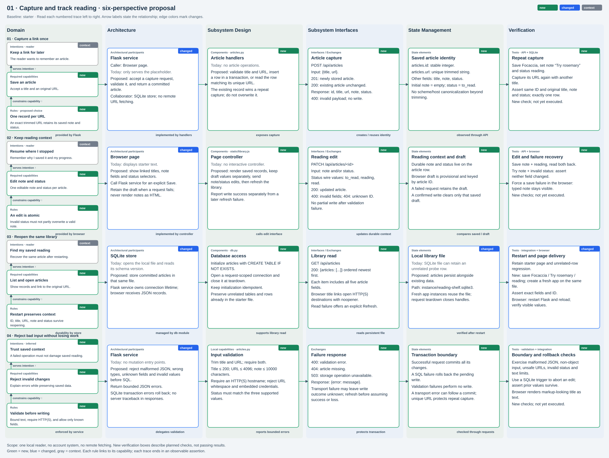
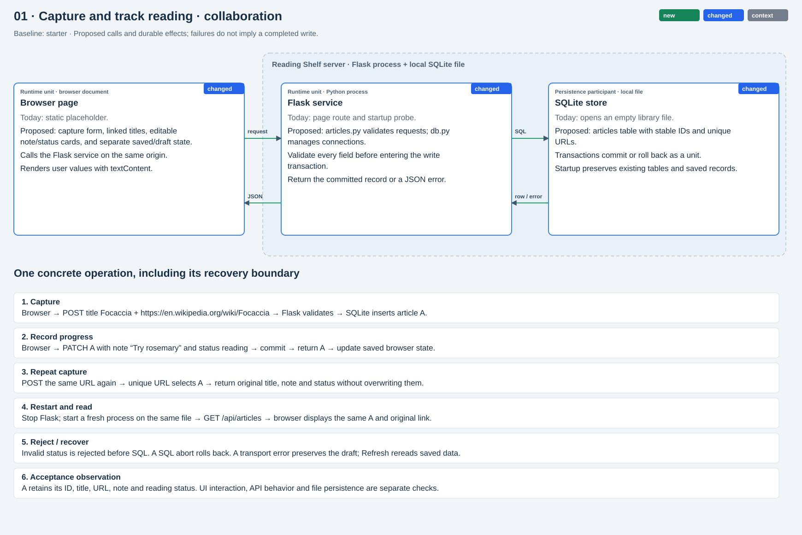
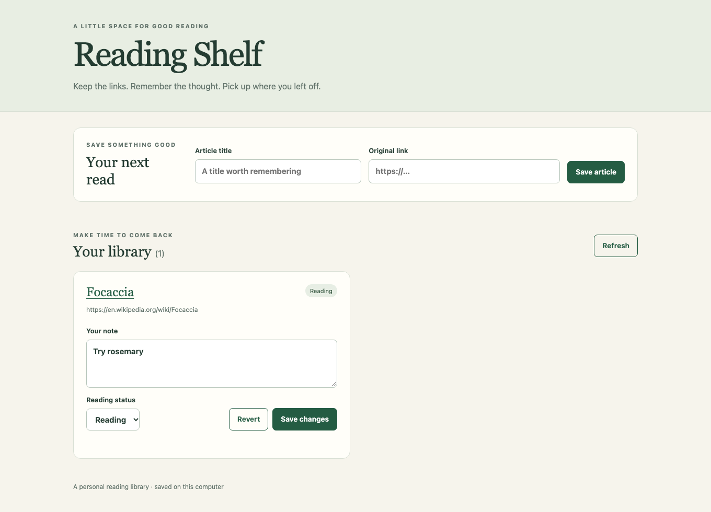

# 01 · Capture and track reading

## Prompt

```text
I would like to develop a full-stack application called Reading Shelf. When I
come across an article I want to read later, I’d like to paste in the link,
give it a title, and save it. Then, when I have time to read, I can open my
library and click the title to get back to the original article.

I often forget why I saved something, so I’d like a place to leave myself a
note. One note per article is plenty, as long as I can edit it later. I’d also
like to keep track of what I’ve started reading. I think “To read”, “Reading”,
and “Read” would cover it. If I leave a note and mark an article “Reading”,
I’d expect to see that note and status again after I restart the app.

I’d like to use Flask to serve the page and a JSON API. Plain HTML, CSS, and
JavaScript are fine for the page, and I’d like to keep my library in a local
SQLite database.

Give me a design proposal [use $ca-design-proposal].
```

## Recorded proposal

A reader needs to save an article and recover its note and reading status after a restart so they can resume reading with the same context.



**Intentions and Rules.** At the starter checkpoint, `create_app` opens SQLite and serves a placeholder; `test_starter_serves_page_and_preserves_the_local_database` proves only page delivery and persistence of an unrelated probe row. There is no article schema, API, or editing UI. The new capabilities are capture, opening the original link, editing one note, and choosing To read, Reading, or Read. A new article starts with an empty note and To read status.

The overview follows four distinct cases: capture a link once, keep reading context, reopen the library, and reject invalid changes. Each rule has a direct link to the capability it constrains. The final lane states an assertion rather than merely naming a test layer.

**Identity decision.** The prompt does not define duplicate URLs. Two captures of the same URL could create independently editable copies, or return one shared record. I recommend one record per exact trimmed URL: a repeated capture returns the existing ID, title, note, and status unchanged. URL variants remain distinct; canonicalization and remote fetching are outside this milestone.



**Architecture and Subsystem Design.** The browser, Flask service, and SQLite store retain their local deployment. Their responsibilities expand from placeholder delivery to a complete save/edit/read path. The original website remains an external destination reached by the reader's browser.

| Package or module | Components: current → proposed responsibility |
| --- | --- |
| `reading_shelf/__init__.py` — changed | Startup probe and page route → schema initialization, article blueprint registration, connection teardown, and bounded JSON storage errors. |
| `reading_shelf/db.py` — new | No database component → request-scoped connections and idempotent article schema initialization, preserving unrelated tables. |
| `reading_shelf/articles.py` — new | No article handlers → capture, listing, partial note/status editing, and validation before transactional writes. |
| `reading_shelf/static/index.html` — changed; `library.css`, `library.js` — new | Placeholder → capture form, linked article cards, independent drafts, status selection, and explicit error recovery. |

**Interfaces and Exchanges.** `GET /api/articles` returns `{articles: [...]}` newest first. `POST /api/articles` takes title and URL and returns the article with 201 for a new record or 200 for an existing one. `PATCH /api/articles/<id>` accepts note and/or status and returns the updated article. Wire statuses are `to_read`, `reading`, and `read`. Invalid payloads return 400, missing records 404, and storage failures 503 with JSON error messages.

Validation requires a nonempty trimmed title of at most 200 characters and an HTTP(S) URL with a hostname, at most 4096 characters, without whitespace, control characters, backslashes, or embedded credentials. Notes preserve their text up to 10000 characters. Unknown fields and wrong types are rejected. Rendering uses text nodes, and external links use `noopener`.

**State Management.** A stable ID, unique URL, title, note, and status live on one article row. All supplied fields are validated before an edit, and the transaction commits them together. An invalid status cannot partly change the note. Request teardown closes the connection; a new app opens the same file. Browser drafts remain separate from saved records and survive a failed save. A confirmed write followed by a failed refresh is reported as such; Refresh retries the read. A transport failure can leave a write's outcome uncertain, so the UI will not claim that nothing was saved.

**Tests.** Run the retained starter regression and new API/SQLite integration tests with `uv run --locked python -m pytest`. Cover duplicate capture, exact restart recovery, malformed input, limits, partial edits, and a SQLite-triggered rollback. Rehearse the browser controls with Focaccia, note “Try rosemary,” and status Reading; restart Flask on the same file and inspect the same record. Check draft retention after a failed save, literal rendering of markup-looking text, and a narrow viewport. These checks are planned here; the implementation report will distinguish executed results from limitations.

Your standing approval applies to this replacement proposal; I will implement it now.

## Recorded implementation report

All **38 automated tests passed**. The Chrome rehearsal verified capture and editing through the visible controls, duplicate-URL identity, recovery after a real Flask restart, the original article link, draft retention after a failed save, and recovery when a save succeeds but the following refresh fails. It also checked literal rendering of markup-looking text and the layout at 390 pixels wide.

The recording includes the replacement proposal, two SVG diagrams, and desktop and mobile screenshots. These checks establish the local single-reader workflow; they do not establish concurrent editing across multiple browser sessions.

## Working result



[Mobile screenshot](assets/01-capture/library-mobile.png)

## Repeat the checks

```sh
uv run --locked python -m pytest -q
```

For the browser check, save Focaccia, set the note to “Try rosemary” and status to Reading, then restart Flask against the same library. Confirm the original link, note, and status are retained. Saving the same URL again should return the existing article without changing its reading context.

[Recording index](README.md)

