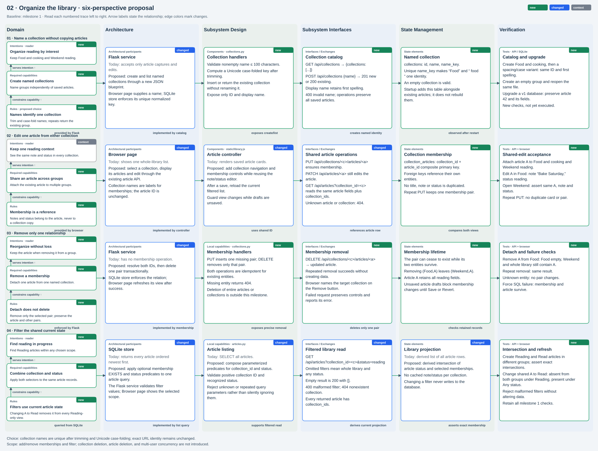
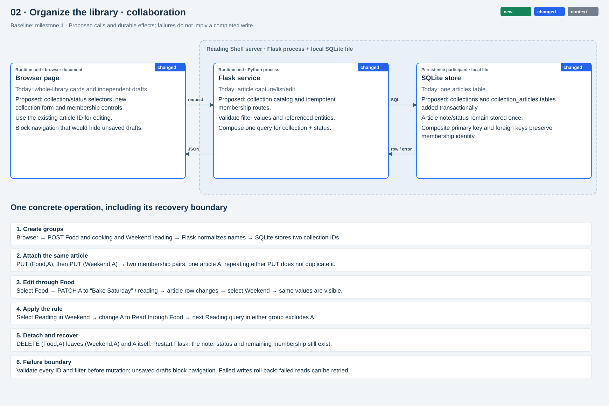
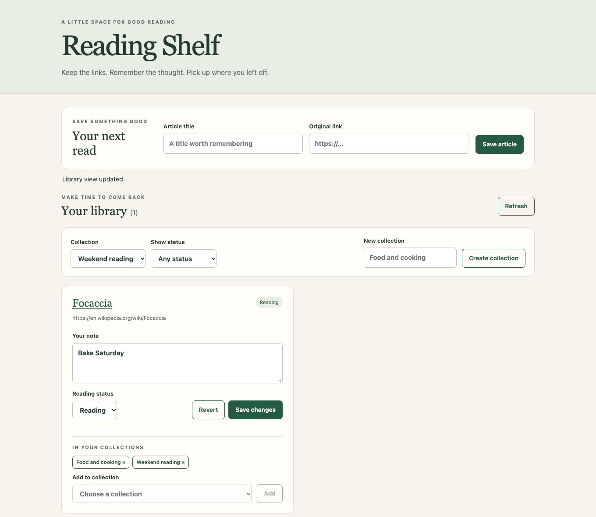

# 02 · Organize the library

## Prompt

```text
Now I’d like the app to support organizing the articles I’ve already saved.
Could you help me figure out how collections would work? I’d like to name them
myself. For example, I might make one called “Food and cooking” and another
called “Weekend reading”. Sometimes I’ll want to put the same article in both.

Say I open that article from “Food and cooking” and change my note. When I
open it later from “Weekend reading”, I’d expect to see the note I just wrote.
And if I decide it doesn’t belong in “Food and cooking” anymore, I’d like to
take it out of that collection and still find it in “Weekend reading” and in
my main library.

I’d also like to see just the articles I’ve marked “Reading”. Sometimes I’d
want that list for my whole library, and sometimes just for one collection. If
I finish an article and mark it “Read” in one collection, it should drop off
the “Reading” list in the other one too.

Give me a design proposal [use $ca-design-proposal].
```

## Recorded proposal

A reader needs to organize saved articles into collections while keeping one shared note and reading status, so reorganizing the library does not fragment their reading context.



**Intentions and Rules.** Baseline contains the milestone 1 implementation. `articles.list_articles` currently returns every saved article, and `edit_article` updates its single note and status. I propose adding named collections and memberships without copying article data. The same article can belong to **Food and cooking** and **Weekend reading**; editing it through either view updates the shared record.

Removing a membership deletes only the selected relationship. The article and its other memberships survive. Status filtering reads the current article row, so changing an article to Read removes it from every Reading-only view on the next read.

**Naming decision.** The prompt leaves duplicate collection names open. Treating `Food` and ` food ` as different groups permits confusing duplicates; treating their trimmed, case-folded names as one identity avoids that. I recommend the latter, preserving the first display spelling. Names are nonempty and limited to 100 characters.



**Subsystem Design — Components.**

| Package or module | Current → proposed responsibility |
| --- | --- |
| `reading_shelf/db.py` — changed | Article initialization → additive collection and membership tables, with unique keys, foreign keys, and an article-membership index. |
| `reading_shelf/collections.py` — new | Collection catalog and idempotent membership operations, with validation of both referenced entities. |
| `reading_shelf/articles.py` — changed | Whole-library listing → combined collection/status queries and article responses containing `collection_ids`. Editing continues to address the article itself. |
| `reading_shelf/static/` — changed | Article cards → collection creation, collection/status selectors, membership controls, and guarded navigation when edits are unsaved. |
| `reading_shelf/__init__.py` — changed | Register the new collection blueprint alongside the article blueprint. |

**Interfaces and Exchanges.** Add `GET/POST /api/collections` and `PUT/DELETE /api/collections/<collection_id>/articles/<article_id>`. Creating an existing normalized name returns its collection unchanged. Repeating a membership addition or removal is harmless when both entities exist; unknown entities return 404.

`GET /api/articles` accepts optional `collection_id` and `status` parameters. Omitted filters mean whole library and any status. Malformed, repeated, or unknown parameters return 400; a nonexistent collection returns 404. Valid filters with no matching articles return an empty list. Saving a new article does not implicitly place it in the currently selected collection.

**State Management.** `collections` stores collection identity and name. `collection_articles` stores unique collection/article pairs with foreign keys. Title, URL, note, and status remain only on the article row. Startup adds the two tables without rebuilding existing articles. The list query uses membership existence and article status as intersecting predicates, avoiding duplicate cards.

Browser drafts remain separate from committed records. Changing a view or membership while drafts exist will ask the reader to Save or Revert first through an explanatory message. A failed filter load retains the previous accepted selection and cards. Confirmed mutations and subsequent refresh failures remain distinguishable.

**Tests.** Retain milestone 1 checks. Add API/SQLite checks for normalized names, duplicate memberships, shared edits, exact filter intersections, relationship-only removal, invalid identifiers, transactional failure, and migration from a populated milestone 1 database. The browser scenario will create both example collections, attach Focaccia to both, change its note to **Bake Saturday** in Food and cooking, and inspect it in Weekend reading. It will also check that changing its status removes it from both Reading views and that detaching it from Food preserves it elsewhere.

Your standing approval applies; I will implement this proposal now.

## Recorded implementation report

All **63 automated tests passed**, including migration from a populated milestone 1 database. The Chrome rehearsal created both collections, added the same article to both, and verified the shared note and status. It also checked that changing the article to Read removed it from both Reading-only views, and that removing it from Food and cooking preserved it in Weekend reading and the whole library after restart.

Draft protection, failed-filter recovery, membership rollback, and narrow-screen layout also passed their checks. The screenshots show the shared note in both collections and the retained article after membership removal.

## Working result





## Repeat the checks

```sh
uv run --locked python -m pytest -q
```

For the browser check, add one article to Food and cooking and Weekend reading. Edit its note and status in one collection and confirm the same values in the other. Check the Reading filter in both collections, then remove the article from Food and cooking and confirm it remains in Weekend reading and the whole library. The application remains a local single-reader example; no concurrent-editor conflict protocol is introduced.

[Recording index](README.md) · [Previous milestone](01-capture.md)

