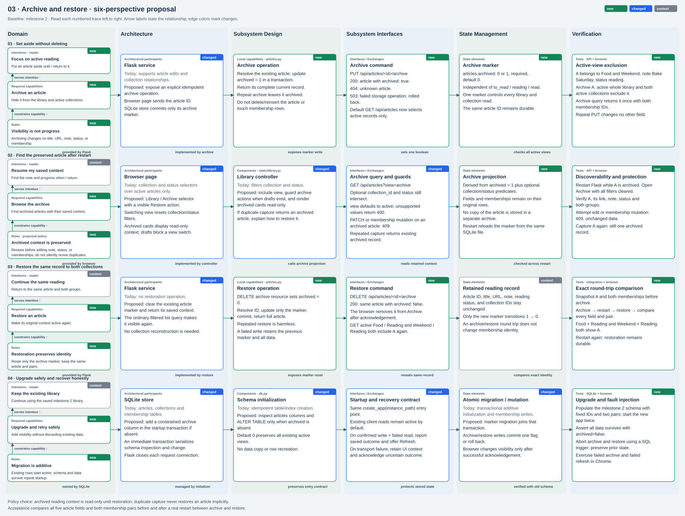
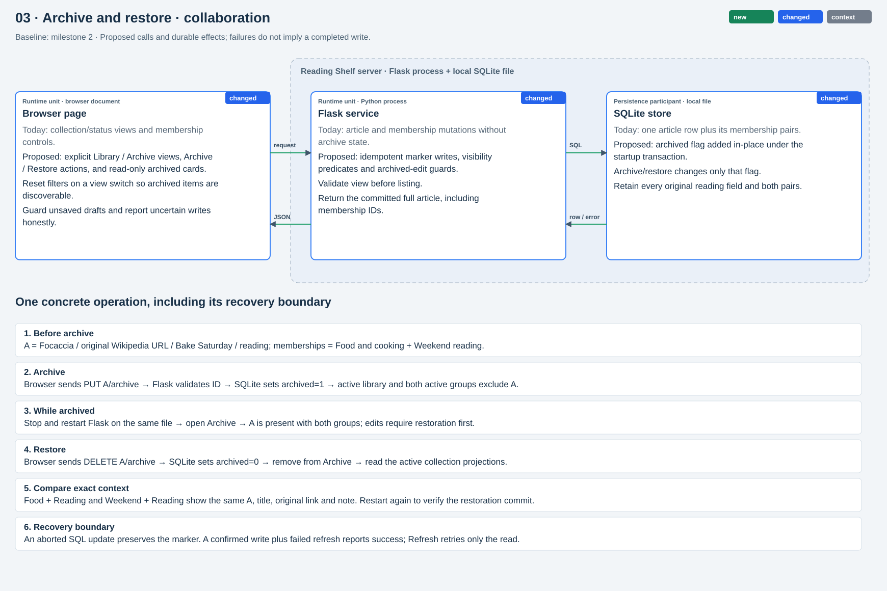
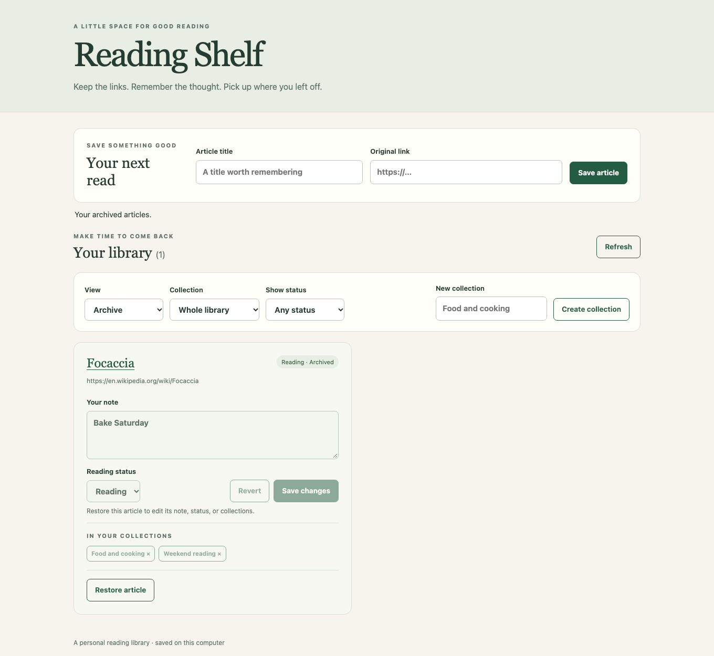
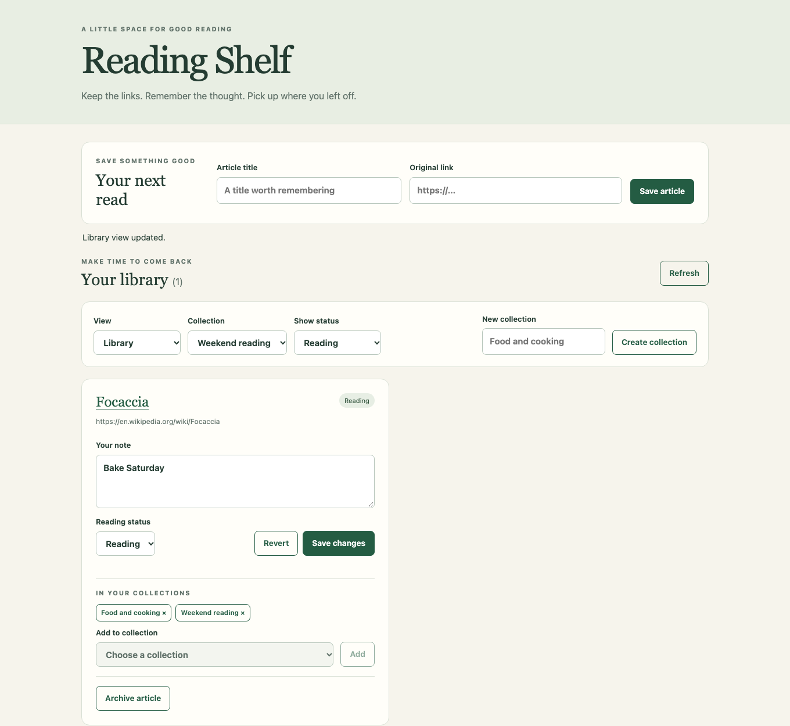

# 03 · Archive and restore

## Prompt

```text
There are articles I’d like to put aside for a while. I’m thinking of adding
an archive. When I archive an article, I want it out of my main library and
out of the collections I’m browsing. I’d like to be able to open the archive
and find it there when I’m ready to come back to it.

For example, I might be halfway through an article that’s in both
“Food and cooking” and “Weekend reading”. I’ve marked it “Reading” and left
myself a note about where I stopped. Suppose I archive it today. When I
restore it, I’d expect it back in my library and in both collections. I should
be able to click the same title to open the original link, see my note, and
carry on with the article still marked “Reading”. This functionality should
work even if the app is restarted between archiving and restoring.

Give me a design proposal [use $ca-design-proposal].

I’d also like to know how I can check that everything comes back when I
restore one.
```

## Recorded proposal

A reader needs to set an article aside and later restore it with the same note, reading status, and collection memberships, so archiving pauses visibility without losing reading context.



**Intentions and Rules.** Baseline contains milestone 2's implementation. Articles already own their note and status, and collections refer to them through membership pairs. I propose adding an independent archive marker. Archiving changes only that marker; active whole-library and collection reads exclude the article. Restoring clears it, revealing the same article through its existing memberships.

**Archived-edit decision.** Allowing note or membership changes while archived would make restoration recover the subsequently edited context. Keeping archived articles read-only preserves the context that was set aside. I recommend requiring restoration before editing notes, statuses, or memberships. A repeated capture of an archived URL will return the existing archived record and explain how to restore it, without silently reactivating it.



**Subsystem Design — Components.**

| Package or module | Current → proposed responsibility |
| --- | --- |
| `reading_shelf/db.py` — changed | Additive table initialization → inspect the article schema and add the archive marker once, inside the existing immediate startup transaction. |
| `reading_shelf/articles.py` — changed | Collection/status listing and edits → mandatory visibility selection, idempotent archive/restore operations, and protection against editing archived context. |
| `reading_shelf/collections.py` — changed | Membership mutations → also reject changes to archived articles, preserving their saved relationships. |
| `reading_shelf/static/` — changed | Library filters and editable cards → explicit Library/Archive selection, Archive/Restore actions, read-only archived cards, and guarded navigation. |

**Interfaces and Exchanges.** Add `PUT /api/articles/<id>/archive` to archive and `DELETE` on the same path to restore. Both return the full article, including a boolean `archived` field and its collection IDs. Repeating either operation is harmless. Unknown IDs return 404; failed storage operations return 503.

`GET /api/articles` gains `view=active|archive`, defaulting to active. Collection and reading-status filters still intersect with visibility; malformed views return 400. Editing an archived article or changing its memberships returns 409. Existing callers retain active-library behavior by default.

**State Management.** The new `articles.archived` column is required, constrained to zero or one, and defaults to zero. Startup inspects the existing schema and adds it only when absent, preserving existing article IDs, fields, collection identities, and membership pairs. Archive and restore update one column transactionally. No archive copy or membership reconstruction is needed.

The browser resets collection and status filters when switching between Library and Archive, making the archive discoverable even after a restrictive active view. Unsaved drafts block view switches and archive actions until saved or reverted. After an acknowledged archive/restore, the card leaves the current view. If the following refresh fails, the message distinguishes the completed write from the failed read; a transport failure retains context and acknowledges that the write outcome may be uncertain.

**Tests and acceptance.** Snapshot Focaccia's ID, title, original URL, note **Bake Saturday**, Reading status, and both memberships. Archive it; assert absence from the whole library and both active collections. Restart Flask while it is archived. Find it in Archive, restore it, and compare every field and both membership pairs with the snapshot. Verify it in Food and cooking and Weekend reading under Reading, then restart again.

Additional checks will cover a populated milestone 2 schema upgrade, repeated startup, idempotent archive/restore, invalid views, archived-edit protection, duplicate capture, SQL rollback, draft guards, and browser failure recovery. The final report will state the observed results.

Your standing approval applies; I will implement this proposal now.

## Recorded implementation report

All **78 automated tests passed**. The checks cover upgrades from the earlier schemas, preserved article fields and memberships, active/archive filtering, duplicate capture, archived-edit protection, and rollback of failed archive or restore operations.

The Chrome rehearsal archived Focaccia while it belonged to both collections, restarted Flask, found the preserved record in Archive, and restored it to both Reading-filtered collections. Its ID, title, original link, note, status, and membership IDs matched the pre-archive snapshot. A second restart confirmed that restoration persisted.

The recording includes the detailed proposal diagrams and archived and restored screenshots. This completes the three milestone pairs; the HTML walkthrough remains outside this work.

## Working result






## Repeat the round trip

1. Save an article, leave a note, and choose Reading.
2. Create Food and cooking and Weekend reading, then add the article to both.
3. Record its title, original URL, note, status, and the two collection names.
4. Archive it. Check the whole library and both active collection views: the article is absent.
5. Stop Flask and restart it against the same instance directory.
6. Choose Archive. Confirm the saved context and both membership labels.
7. Restore the article. Open each collection with Reading selected and compare the recorded values.
8. Restart Flask again and confirm the restored article remains active.

The automated integration test also compares the stable article ID and both exact membership pairs.

```sh
uv run --locked python -m pytest -q
```

Archived context is intentionally read-only until restoration. The implementation is a local single-reader example; concurrent editing across tabs has no conflict-resolution protocol.

[Recording index](README.md) · [Previous milestone](02-collections.md)

